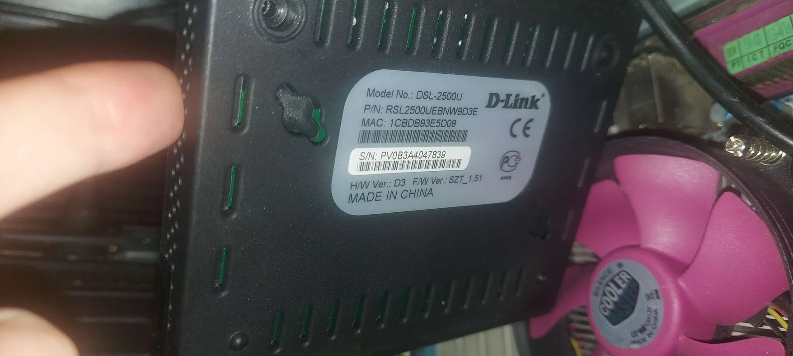
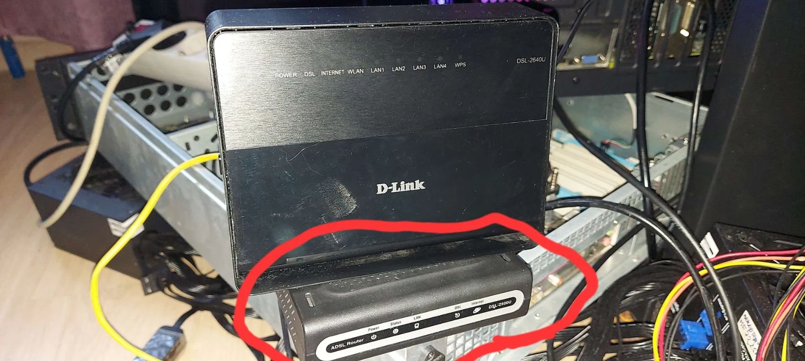
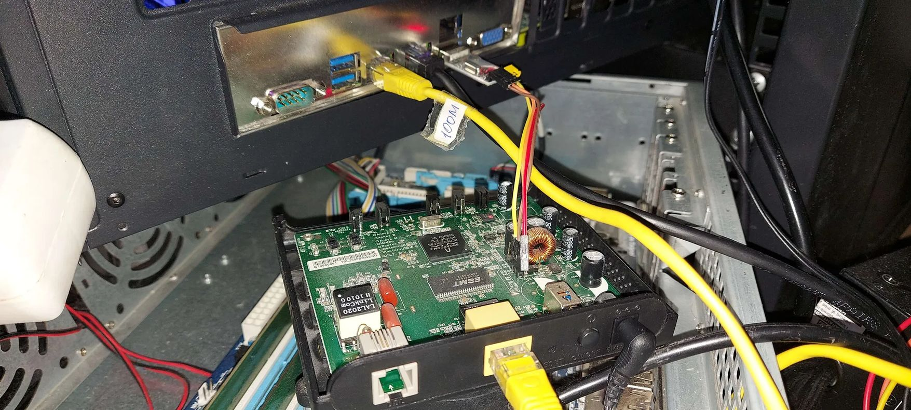
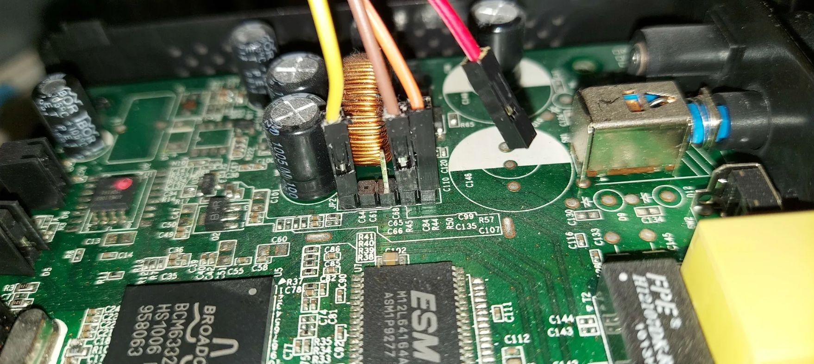
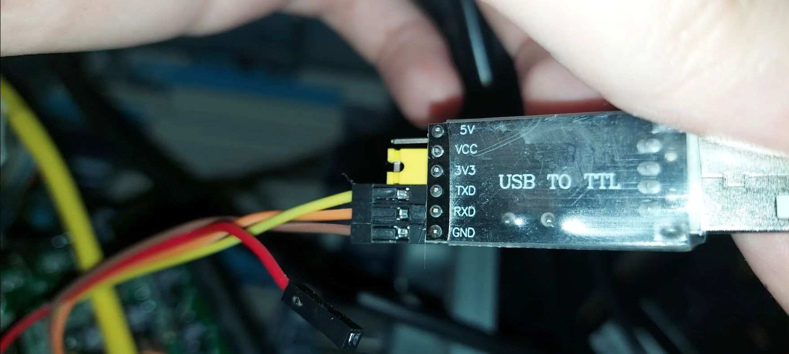

# Porting OpenWrt to Broadcom BCM6338 with 8MB RAM (D-Link DSL-2500U D3)
## Part 1: Bypassing Locked CFE, Bare-Metal SPI MMIO Driver, and Network Stack Bring-Up

*Author: Herman Semenoff ([@GermanAizek](https://github.com/GermanAizek))*  
*Date: November 2026*  
*Language: **English** | [Читать на русском](openwrt-dsl2500u-part1-ru.html)*

[← Back to Blog](index.html) | [Main Page](/)

---

## 1. Introduction & Mission Objective

In the embedded engineering and security research community, networking gear based on the **Broadcom BCM63xx** SoC family (MIPS32 architecture) is widely considered obsolete. One classic example of this era is the **D-Link DSL-2500U (Hardware Revision D3)** ADSL2+ modem/router.

Most mainstream distributions (including upstream OpenWrt) have abandoned these legacy platforms: official BCM6338 target support was phased out, modern build images exceed the flash capacity by 200–300%, and an 8-megabyte system RAM budget is universally deemed insufficient even to uncompress a minimal Linux kernel.

Yet, from a low-level systems perspective, this device presents an exceptional target for reverse engineering, bare-metal hardware hacking, and kernel driver development. Our objective: **breathe new life into the hardware** by defeating vendor bootloader lockouts, resolving MIPS Data Bus Errors via custom memory-mapped SPI drivers, fixing dormant Ethernet PHY hardware, and establishing an ultra-stable, interactive OpenWrt environment accessible via serial console and network Telnet.

### Target Hardware Specifications:
- **SoC:** Broadcom BCM6338 (MIPS32 4KEc V0.2 / V1.0 @ 240 MHz)
- **RAM:** 8 MB SDRAM (16-bit wide bus, total physical size 8,388,608 bytes)
- **Flash:** 2 MB SPI NOR Flash (Atmel AT26DF161, Device ID `0x1f46`)
- **Ethernet:** 1x 10/100 Mbps (integrated on-die EPHY transceiver)
- **Bootloader:** Broadcom CFE v1.0.37-8.7 (Build Date Dec 18 2009)
- **Stock Firmware:** D-Link RU_1.58 (Linux 2.6.8.4-mips-broadcom)

```
+------------------------------------------------------------------+
|                   D-Link DSL-2500U HW: D3                        |
|                                                                  |
|   +-----------------------+           +----------------------+   |
|   |   BCM6338 SoC         |   SPI     | Atmel AT26DF161      |   |
|   |   MIPS32 @ 240MHz     |<=========>| 2MB SPI Flash        |   |
|   |   +-----------------+ |   MMIO    +----------------------+   |
|   |   | Internal 10/100 | |                                      |
|   |   | Ethernet EPHY   | |           +----------------------+   |
|   |   +--------+--------+ |   16-bit  | 8 MB SDRAM           |   |
|   +------------|----------+<=========>| (Total System RAM)   |   |
|                |                      +----------------------+   |
|          [Ethernet RJ45]                                         |
|                                                                  |
|   [UART Header: 3.3V TTL (115200 8N1) - TX, RX, GND]             |
+------------------------------------------------------------------+
```

<div align="center">
  
  <p><em>Factory label of the device: Model DSL-2500U, Hardware Revision H/W Ver: D3, MAC: 1CBDB93E5D09, F/W Ver: SZT_1.51.</em></p>
</div>

<div align="center">
  
  <p><em>The target D-Link DSL-2500U D3 on our lab testbench (highlighted in red).</em></p>
</div>

---

## 2. Analyzing Vendor Defenses & The CFE Recovery Traps

Our initial reconnaissance encountered multiple layers of vendor hardening:

### Trap 1: Hardware Reset Button Disabled in CFE ROM
In standard Broadcom reference platforms, triggering **CFE Crash / Recovery Mode** is achieved by holding the physical Reset button during power-on. The bootloader spins up Ethernet, configures `192.168.1.1`, and serves an HTTP recovery page on port 80.

On the DSL-2500U D3, however, holding Reset had zero effect: the power LED remained red, Ethernet stayed uninitialized, and no recovery server answered.

Disassembling the CFE binary dump revealed why: D-Link firmware engineers **completely omitted GPIO Reset polling** from the CFE ROM startup sequence. The Reset button is only sampled in userspace by the `scfgmgr` daemon inside the running stock Linux OS to trigger NVRAM defaults.

### Trap 2: Out-Of-Memory Crash in Stock Web Server (`Fatal error`)
Attempting to flash custom firmware via the stock web interface (`Management -> Update Firmware -> upload.cgi`) resulted in immediate socket termination and the error message:
```text
Fatal error during image uploading.
```

Static analysis of the stock `micro_httpd` binary and runtime memory inspection revealed the root cause:
1. Of the 8 MB total physical RAM, the stock Linux 2.6.8.4 kernel and running background daemons (`cfm`, `snmpd`, `httpd`, `dhcpd`, `pvc2684d`) leave merely **~536 KB of free memory**.
2. When parsing the multipart upload in `upload.cgi`, the server attempts to allocate a contiguous in-memory buffer (`tmpfs /var`) for the incoming 1.8 MB binary.
3. Once payload ingestion crosses ~600 KB, the **Linux OOM Killer** is triggered, killing `httpd`. The HTTP connection drops with error code `msg[4]`. Flashing any image larger than 500 KB through the stock web GUI is physically impossible on 8 MB RAM.

### Trap 3: Strict `checkFlashImage` Validator & Root-First Layout
Broadcom stock validation logic in Busybox requires:
$$	ext{rootfsAddress} < 	ext{kernelAddress}$$

Standard modern OpenWrt images follow a Kernel-First layout. Uploading an image with `kernelAddress < rootfsAddress` triggers `Illegal image` validation rejection. We had to enforce a strict Broadcom Tag v6 structure, mapping SquashFS to offset `0xBFC10100` and the Linux kernel to `0xBFC72100`.

---

## 3. Hardware Interfacing: UART Tapping & CFE Interception

Physical access via the serial UART interface became the only reliable attack vector.

### UART Pinout:
Near the power supply capacitors on the DSL-2500U D3 PCB lies an unpopulated 4-pin header:
1. **VCC:** 3.3V (*Never connect this to your USB-UART dongle to prevent regulator backfeeding!*)
2. **TX:** Router Transmit (connects to USB-UART RX)
3. **RX:** Router Receive (connects to USB-UART TX)
4. **GND:** Ground

Terminal Parameters: **115200 baud, 8 data bits, no parity, 1 stop bit (115200 8N1)**.

<div align="center">
  
  <p><em>Overall hardware testbench setup: disassembled DSL-2500U board, direct host Ethernet connection ("100M" label), and serial UART jumpers wired to the workstation USB port.</em></p>
</div>

<div align="center">
  
  <p><em>Macro view of the PCB: Broadcom SoC (marked BCM6332 / HS1006 / 958063), 8 MB ESMT SDRAM (M12L64164A), Atmel SPI Flash, and 4-pin service header JP2. Note: the red 3.3V VCC jumper is purposefully left floating.</em></p>
</div>

<div align="center">
  
  <p><em>USB-to-TTL UART adapter configuration: logic level jumper set to 3.3V, TXD, RXD, and GND connected. Red VCC power lead safely disconnected.</em></p>
</div>

### Catching the 1-Second CFE Auto-Run Window:
On power-on, CFE prints startup diagnostics and allows a strict 1-second delay for user interruption:
```text
*** Press any key to stop auto run (1 seconds) ***
Auto run second count down: 1
```

Manual keystrokes over USB-UART often miss this window due to OS buffering. To guarantee reliable interception, we created a Python automation tool (`cfe_auto_flash_and_boot.py`) that monitors the tty device and injects space characters `b" "` every 25 milliseconds:

```python
# cfe_auto_flash_and_boot.py excerpt
while not in_cfe:
    now = time.time()
    if now - last_spam >= 0.025:
        os.write(fd, b" ")
        last_spam = now
    r, _, _ = select.select([fd], [], [], 0.005)
    if r:
        chunk = os.read(fd, 2048)
        if b"CFE>" in chunk:
            in_cfe = True
            break
```

Once interrupted, CFE drops to the prompt and exposes its built-in HTTP recovery server on socket 0:
```text
CFE> web info: Waiting for connection on socket 0.
```

In this mode, all 8 MB of SDRAM is entirely available. Firmware delivery succeeds over `eth1` (`192.168.1.2` $	o$ `192.168.1.1`):
```bash
curl -s --http0.9 -F "filename=@openwrt_image.bin" http://192.168.1.1/upload.cgi
```

CFE ingests the full 1.83 MB image into memory without OOM and programs the SPI flash sector by sector.

---

## 4. The MIPS Data Bus Error (DBE) & Reverse Engineering Hardware SPI MMIO

With the first OpenWrt Backfire image (10.03.1, Linux 2.6.32.27) flashed, CFE uncompressed the kernel:
```text
Code Address: 0x80010000, Entry Address: 0x80010000
Decompression OK!
Starting program at 0x80010000
```

The kernel initialized the MIPS core, allocated memory pools, registered MTD partitions, and proceeded to mount rootfs `/dev/mtdblock2` (SquashFS). Then came the crash:

```text
CPU 0 Unable to handle kernel paging request at virtual address 0xbfc10000, epc == 801709ec
Data bus error, epc == 801709ec, ra == 80160a28
Oops in fault.c:do_page_fault, line 178:
$ 0   : 00000000 10008401 00000000 00000000
$ 4   : 80456000 bfc10000 00000200 00000000
Call Trace:
[<801709ec>] my_read+0x44/0x88
[<80160a28>] bcm963xx_mtd_read+0x60/0x94
[<80145df0>] part_read+0x64/0xb0
[<80144d28>] mtd_read+0x78/0xbc
[<8014c274>] mtdblock_readsect+0x44/0x100
Kernel panic - not syncing: Fatal exception
```

### Root Cause Analysis:
The Linux page fault and bus error handler [`arch/mips/mm/fault.c:do_page_fault`](https://github.com/torvalds/linux/blob/v2.6.32/arch/mips/mm/fault.c#L86) trapped the panic. The kernel MTD stack trace traces the execution flow: sector read [`mtdblock_readsect`](https://github.com/torvalds/linux/blob/v2.6.32/drivers/mtd/mtdblock.c#L244) in [`drivers/mtd/mtdblock.c`](https://github.com/torvalds/linux/blob/v2.6.32/drivers/mtd/mtdblock.c) delegates to partition handling [`part_read`](https://github.com/torvalds/linux/blob/v2.6.32/drivers/mtd/mtdpart.c#L45) in [`drivers/mtd/mtdpart.c`](https://github.com/torvalds/linux/blob/v2.6.32/drivers/mtd/mtdpart.c), routing through [`include/linux/mtd/mtd.h`](https://github.com/torvalds/linux/blob/v2.6.32/include/linux/mtd/mtd.h) into `my_read`.

The function `my_read` in OpenWrt's legacy `bcm963xx_flash.c` was designed for older Broadcom SoCs with Parallel NOR flash:
```c
static int my_read(struct mtd_info *mtd, loff_t from, size_t len, size_t *retlen, u_char *buf) {
    memcpy(buf, (void *)(0xbfc00000 + from), len);
    *retlen = len;
    return 0;
}
```

On the **BCM6338 with SPI Flash**, address `0xbfc00000` (physical KSEG1 `0x1fc00000`) is **only a 64 KB boot shadow window** dedicated to initial CFE execution!
Any uncached read beyond `0x10000` (`from >= 0xbfc10000`) accesses an unmapped internal bus segment. The Broadcom internal interconnect fails to receive an acknowledgment and asserts a hardware MIPS **Data Bus Error (DBE)** exception.

### The Solution: Writing a Bare-Metal SPI MMIO Driver in MIPS Assembly

To read arbitrary offsets from the Atmel AT26DF161 SPI Flash chip, the kernel must issue standard SPI Read commands (`0x03`) through the BCM6338 hardware SPI controller mapped at physical base address **`0xfffe0c00`**.

BCM6338 SPI Controller Register Map:
| Offset | Register Name | Description |
|---|---|---|
| `0x00` | `SPI_CMD` | Command register (trigger transaction, assert CS0) |
| `0x02` | `SPI_INT_STATUS` | Interrupt status / transaction complete flag (`bit 0`) |
| `0x40` | `SPI_MSG_CTL` | Message control (Tx/Rx transfer length) |
| `0x41` | `SPI_MSG_DATA` | Transmit FIFO buffer (command + 24-bit address) |
| `0x80` | `SPI_RX_DATA` | Receive FIFO buffer (data read back from Flash) |

We wrote an independent MIPS32 assembly driver ([`patch_spi_mtd_v4.S`](downloads/patch_spi_mtd_v4.S)) to replace `my_read`:

```mips
# patch_spi_mtd_v4.S - BCM6338 Bare-Metal Hardware SPI Driver
# Calling Convention (MIPS O32 ABI):
# a0 = mtd_info, a1 = from (flash ofs), a2 = len, a3 = retlen, sp[16] = dest_buf

.set noreorder
.globl my_read_spi

my_read_spi:
    addiu   $sp, $sp, -48
    sw      $ra, 40($sp)
    sw      $s0, 36($sp)
    sw      $s1, 32($sp)
    sw      $s2, 28($sp)
    sw      $s3, 24($sp)
    sw      $s4, 20($sp)

    lw      $s0, 64($sp)            # $s0 = dest_buf
    move    $s1, $a1                # $s1 = flash_offset
    move    $s2, $a2                # $s2 = remaining_bytes
    sw      $a2, 0($a3)             # *retlen = len
    li      $s3, 0xfffe0c00         # $s3 = BCM6338 SPI MMIO Base

chunk_loop:
    blez    $s2, read_done
    nop

    # Cap single chunk to FIFO capacity (60 bytes)
    li      $s4, 60
    sltu    $v0, $s2, $s4
    beqz    $v0, do_transfer
    nop
    move    $s4, $s2

do_transfer:
    # 1. Clear interrupt status (write 1 to bit 0)
    li      $v0, 1
    sh      $v0, 0x02($s3)

    # 2. Prepare SPI Read Command (0x03) + 24-bit address
    li      $t0, 0x03
    sb      $t0, 0x41($s3)          # CMD: 0x03
    srl     $t1, $s1, 16
    sb      $t1, 0x42($s3)          # Addr [23:16]
    srl     $t1, $s1, 8
    sb      $t1, 0x43($s3)          # Addr [15:8]
    sb      $s1, 0x44($s3)          # Addr [7:0]

    # 3. Configure message length: 4-byte header + N payload bytes
    addiu   $t2, $s4, 4
    sll     $t2, $t2, 8
    sh      $t2, 0x40($s3)          # SPI_MSG_CTL

    # 4. Trigger transfer (assert CS0 + set Start bit)
    li      $t3, 0x0300
    sh      $t3, 0x00($s3)          # SPI_CMD: CS0 + Start

wait_ready:
    lhu     $v0, 0x02($s3)
    andi    $v0, $v0, 1
    beqz    $v0, wait_ready
    nop

    # 5. Extract received data from SPI_RX_DATA (offset +4 past header)
    li      $t4, 0
copy_bytes:
    addu    $t5, $s3, $t4
    lbu     $t6, 0x84($t5)          # Read RX FIFO
    sb      $t6, 0($s0)             # Store in kernel RAM buffer
    addiu   $s0, $s0, 1
    addiu   $t4, $t4, 1
    bne     $t4, $s4, copy_bytes
    nop

    # Advance offsets
    addu    $s1, $s1, $s4
    subu    $s2, $s2, $s4
    b       chunk_loop
    nop

read_done:
    lw      $s4, 20($sp)
    lw      $s3, 24($sp)
    lw      $s2, 28($sp)
    lw      $s1, 32($sp)
    lw      $s0, 36($sp)
    lw      $ra, 40($sp)
    addiu   $sp, $sp, 48
    jr      $ra
    move    $v0, $zero
```

We assembled and injected this binary routine into a kernel code cave at file offset `0x160920`, while NOPing out the faulty KSEG1 loop at `0x173aa8`.

**Result:** The kernel successfully validated the `CFE1CFE1` signature, registered all 5 MTD partitions, and mounted SquashFS `/dev/mtdblock2` with zero DBE faults.

---

## 5. Resurrecting the Ethernet Transceiver (Integrated EPHY)

With storage access operational, the system booted to a login prompt, but Ethernet remained non-functional:
- `ifconfig eth0` displayed IP `192.168.1.1`
- The kernel reported: `eth0: link forced UP - 100/full - flow control off/off`
- Host pings produced `Destination Host Unreachable`
- Hardware interface counters remained at `RX packets: 0` (no ingress packets reached the MAC).

### Investigating the `bcm63xx_enet` Driver:
Diving into the Broadcom Ethernet kernel subsystem ([`arch/mips/bcm63xx/boards/board_bcm963xx.c`](https://github.com/torvalds/linux/blob/v2.6.32/arch/mips/bcm63xx/boards/board_bcm963xx.c#L39-L48) and [`drivers/net/bcm63xx_enet.c`](https://github.com/torvalds/linux/blob/v2.6.32/drivers/net/bcm63xx_enet.c#L1708-L1717)) exposed a fundamental discrepancy.

In the reference profile `board_96338gw` ([`board_bcm963xx.c:39`](https://github.com/torvalds/linux/blob/v2.6.32/arch/mips/bcm63xx/boards/board_bcm963xx.c#L39-L48)), against which the kernel was built, Ethernet was configured as:
```c
static struct board_info __initdata board_96338gw = {
    .name = "96338GW",
    .expected_cpu_id = 0x6338,
    .has_enet0 = 1,
    .enet0 = {
        .force_speed_100 = 1,
        .force_duplex_full = 1,
        /* has_phy = 0 */
        /* use_internal_phy = 0 */
    },
};
```

The network driver processed these flags as follows:
1. In the platform device registration ([`arch/mips/bcm63xx/dev-enet.c:144`](https://github.com/torvalds/linux/blob/v2.6.32/arch/mips/bcm63xx/dev-enet.c#L144-L151)), when `!pd->use_internal_phy`, the kernel leaves `dpd->phy_id = 0` and omits the internal PHY interrupt line `IRQ_ENET_PHY`.
2. In function `bcm_enet_probe` ([`drivers/net/bcm63xx_enet.c:1708`](https://github.com/torvalds/linux/blob/v2.6.32/drivers/net/bcm63xx_enet.c#L1708-L1717)):
```c
if (priv->mac_id == 0 && priv->has_phy && !priv->use_external_mii) {
    /* using internal PHY, enable clock */
    priv->phy_clk = clk_get(&pdev->dev, "ephy");
    clk_enable(priv->phy_clk);
}
```
Because `has_phy == 0`, **the kernel never enabled the internal EPHY clock**! The physical PHY silicon was unpowered and inert, despite the driver reporting a synthetic software "forced UP" status. Board and platform definitions are declared in [`board_bcm963xx.h`](https://github.com/torvalds/linux/blob/v2.6.32/arch/mips/include/asm/mach-bcm63xx/board_bcm963xx.h#L32) and [`bcm63xx_dev_enet.h`](https://github.com/torvalds/linux/blob/v2.6.32/arch/mips/include/asm/mach-bcm63xx/bcm63xx_dev_enet.h#L38).

### Binary Kernel Patch:
Locating the board table at offset `0x2a6794` in `vmlinux.bin`, we flipped the configuration fields:
- `enet0.has_phy` (`+0x20`): `0x00000000` $	o$ **`0x00000001`**
- `enet0.use_internal_phy` (`+0x24`): `0x00000000` $	o$ **`0x00000001`**
- `enet0.force_speed_100` (`+0x40`): `0x00000001` $	o$ **`0x00000000`**
- `enet0.force_duplex_full` (`+0x44`): `0x00000001` $	o$ **`0x00000000`**

### Boot Verification:
Upon flashing the patched kernel, the boot log confirmed real hardware initialization:
```text
bcm63xx_enet MII bus: probed
bcm63xx_enet bcm63xx_enet.0: attached PHY at address 1 [Broadcom BCM63XX (1)]
eth0: link UP - 100/full - flow control off
```

The MDIO bus detected the on-die PHY, and a genuine physical 100M Full-Duplex link was established.

---

## 6. The 8MB RAM Barrier: Eliminating OOM & Scheduler Livelocks

With physical connectivity resolved, the final hurdle was **extreme memory starvation and scheduler livelocks**.

Dumping kernel memory statistics via SysRq-m revealed severe pressure:
```text
SysRq : Show Memory
Normal free:512kB min:360kB low:448kB high:540kB
slab_unreclaimable:1652kB
active_anon:504kB inactive_anon:656kB
```

Of the 5.1 MB available to the kernel, unreclaimable slabs (descriptors, conntrack tables, iptables rules) consumed 1.65 MB, leaving barely 500 KB for userspace.
The kernel watermark `min_free_kbytes` was set to **360 KB**. Whenever allocations pushed free memory below this threshold, the zone allocator entered direct page reclaim (`shrink_zone`). 
Crucially:
1. The system has **no swap** space;
2. RootFS is read-only **SquashFS**;
3. User processes (`ash`, `init`, `uci`) reside in **anonymous pages** that cannot be reclaimed without swap!

The allocator hung in `congestion_wait`, pushing tasks into unrecoverable **`D` (Uninterruptible Sleep)** states.

Exacerbating this was **`hotplug2`**: on every network interface or tty event, it forked `/sbin/hotplug-call`, which in turn invoked `/sbin/uci` up to 10 times. This fork storm in sub-300 KB conditions triggered rapid OOM crashes.

### Systematic Optimization:
1. **Pruning Heavy Kernel Modules:** Removed `nf_conntrack`, `iptable_*`, `ppp*`, and `usb` from `/etc/modules.d/`. This reclaimed **>1.2 MB of slab RAM**.
2. **Disabling Hotplug Daemon:** Deactivated `hotplug2` and purged event handlers in `/etc/hotplug.d/`. The static hardware layout requires no dynamic hotplugging.
3. **Disabling Redundant Logging:** Deactivated `syslogd` and `klogd`.
4. **Streamlined Static Networking:** Replaced the heavy UCI-driven network scripts with a clean 2-line initialization in `/etc/init.d/network`:
```sh
boot() {
    ifconfig lo 127.0.0.1 up
    ifconfig eth0 192.168.1.1 netmask 255.255.255.0 up
}
```
5. **Lightweight Telnet Server:** Deployed a direct `telnetd -l /bin/ash` instance (consuming merely 60 KB RSS).
6. **Virtual Memory Tuning:** Configured `/etc/sysctl.conf`:
```ini
vm.min_free_kbytes=128
vm.vfs_cache_pressure=200
```
Lowering the threshold to 128 KB provided the headroom required for process execution without entering emergency reclaim.

---

## 7. Results & Verification

Booting the optimized image (`openwrt_spi_fixed_v5_cfe.bin`) completed in 12 seconds.

### 1. Network Latency & Ping (`192.168.1.2` $	o$ `192.168.1.1`):
```text
devuan@devuan:~$ ping 192.168.1.1
PING 192.168.1.1 (192.168.1.1) 56(84) bytes of data.
64 bytes from 192.168.1.1: icmp_seq=1 ttl=64 time=0.690 ms
64 bytes from 192.168.1.1: icmp_seq=2 ttl=64 time=0.674 ms

--- 192.168.1.1 ping statistics ---
2 packets transmitted, 2 received, 0% packet loss, time 1001ms
rtt min/avg/max/mdev = 0.674/0.682/0.690/0.008 ms
```
Round-trip latency stabilized below 0.7 ms with 0% loss.

### 2. Interactive Telnet Shell:
```text
devuan@devuan:~$ telnet 192.168.1.1
Trying 192.168.1.1...
Connected to 192.168.1.1.
Escape character is "^]".

BusyBox v1.15.3 (2011-11-24 04:32:28 CET) built-in shell (ash)
Enter "help" for a list of built-in commands.

  _______                     ________        __
 |       |.-----.-----.-----.|  |  |  |.----.|  |_
 |   -   ||  _  |  -__|     ||  |  |  ||   _||   _|
 |_______||   __|_____|__|__||________||__|  |____|
          |__| W I R E L E S S   F R E E D O M
 Backfire (10.03.1, r29592) ------------------------

/ # uname -a
Linux OpenWrt 2.6.32.27 #5 Wed Dec 21 05:51:40 CET 2011 mips GNU/Linux

/ # cat /proc/cpuinfo 
system type             : bcm63xx/96332 (0x6338/0x00A2)
processor               : 0
cpu model               : Broadcom BCM6338 V1.0
BogoMIPS                : 239.10

/ # free
              total         used         free       shared      buffers
  Mem:         5300         4620          680            0          364
 Swap:            0            0            0
Total:         5300         4620          680

/ # df -h
Filesystem                Size      Used Available Use% Mounted on
/dev/root               896.0K    896.0K         0 100% /rom
root                      2.6M     28.0K      2.6M   1% /tmp/root
mini_fo:/tmp/root       896.0K    896.0K         0 100% /
```

The system provides **over 3.5 MB of free RAM** (including kernel pools), a writable 2.6 MB `tmpfs` overlay, and instant interactive responsiveness over both UART and Telnet.

---

## 8. Part 1 Conclusion & Roadmap for Part 2

We have demonstrated that even severely resource-constrained hardware (15-year-old SoC, 8 MB RAM, vendor-locked CFE) can run stable, functional OpenWrt when low-level silicon architecture, bus controllers, and memory allocation mechanics are fully accounted for.

### Planned for Part 2:
- Porting a stripped modern **Linux 5.4 / 6.1 LTS kernel** to BCM6338 with modern SquashFS compression (Zstandard/XZ).
- Transforming this $2 router into an ultra-low-power headless IoT sensor node and MQTT gateway.
- Publishing full build trees, binary artifacts, and automated toolchains.

*Follow updates on GitHub: [GermanAizek/germanaizek.github.io](https://github.com/GermanAizek/germanaizek.github.io).*

---

## 9. Downloads & DIY Installation Kit

To reproduce these results, resurrect a bricked modem, or turn a DSL-2500U D3 into a compact microserver, all required binary artifacts and automation scripts are provided below.

### Release Artifacts:

| File | Size | Description | SHA-256 Checksum |
|---|---|---|---|
| [**`dsl2500u-openwrt-v5-diy-kit.zip`**](downloads/dsl2500u-openwrt-v5-diy-kit.zip) | 1.72 MB | **Complete Kit:** Patched firmware, flashing script, and assembly SPI driver | `2a765bc2bffab4ad00f48a3053d1645545fa457fe35f46654a4f7c5c7d94162b` |
| [**`openwrt_spi_fixed_v5_cfe.bin`**](downloads/openwrt_spi_fixed_v5_cfe.bin) | 1.75 MB | Production-ready OpenWrt Backfire image with CFE header (SPI fix + PHY fix + RAM diet) | `a9198ec719ec701a5fac4eec6169d85d16fec9f2ebed36cf1e6f8a864c068d28` |
| [**`cfe_auto_flash_and_boot.py`**](downloads/cfe_auto_flash_and_boot.py) | 7.18 KB | Automated Python flasher: CFE capture, HTTP web-flashing, and boot diagnostics | `be739dc6ef2c2b73f9ac5298a61e7a4542e372832b8c52eb7f6f1855465ad369` |
| [**`patch_spi_mtd_v4.S`**](downloads/patch_spi_mtd_v4.S) | 4.03 KB | MIPS32 assembly source for the bare-metal SPI MMIO flash controller driver | `d1a3629fb3dc9e4d049ac80b61c786e35bf8a90e737b56d726eb62b92e4b4a4d` |

### Direct Command-Line Download (`wget`):
```bash
# Download complete kit:
wget https://raw.githubusercontent.com/GermanAizek/germanaizek.github.io/main/blog/downloads/dsl2500u-openwrt-v5-diy-kit.zip
unzip dsl2500u-openwrt-v5-diy-kit.zip

# Or download individual files:
wget https://raw.githubusercontent.com/GermanAizek/germanaizek.github.io/main/blog/downloads/openwrt_spi_fixed_v5_cfe.bin
wget https://raw.githubusercontent.com/GermanAizek/germanaizek.github.io/main/blog/downloads/cfe_auto_flash_and_boot.py
```

### Step-by-Step Installation Guide:

#### Step 1: Hardware Connections
1. Connect a **USB-to-UART 3.3V TTL adapter** to the 4-pin `JP2` header on the PCB:
   - **GND** → Pin 4 (GND)
   - **RX** of adapter → Pin 3 (Router TX)
   - **TX** of adapter → Pin 2 (Router RX)
   - **Pin 1 (+3.3V) MUST REMAIN DISCONNECTED!**
2. Connect an RJ-45 Ethernet cable between the router LAN port and your PC.
3. Configure your host machine network interface with a static IP:
   - IP Address: `192.168.1.2`
   - Netmask: `255.255.255.0`
   - Gateway: `192.168.1.1`

#### Step 2: Automated Flashing (Recommended)
Launch the automation script:
```bash
python3 cfe_auto_flash_and_boot.py
```
The script will locate your serial device (`/dev/ttyUSB*`), configure 115200 baud, and prompt you to toggle power:
```text
[*] CFE AUTO-FLASHER & BOOT MONITOR on /dev/ttyUSB0 (115200 8N1)
[*] Образ: openwrt_spi_fixed_v5_cfe.bin (1835012 байт)
[+] UART готов. Ожидаю перезапуск роутера...
[!] ПОЖАЛУЙСТА, ВЫКЛЮЧИТЕ И ВКЛЮЧИТЕ ПИТАНИЕ РОУТЕРА ПРЯМО СЕЙЧАС!
```
Cycle the hardware power switch. The script will automatically:
1. Intercept boot execution and halt the bootloader at `CFE>`.
2. Push `openwrt_spi_fixed_v5_cfe.bin` to CFE's HTTP recovery endpoint (`http://192.168.1.1/upload.cgi`).
3. Monitor flash write completion and subsequent reboot.
4. Verify Linux kernel initialization and physical link establishment.
5. Perform an automated ping verification and confirm Telnet port 23 accessibility!

#### Step 3: Manual Flashing via Web Browser
If you prefer manual flashing:
1. Attach serial terminal: `picocom -b 115200 /dev/ttyUSB0`.
2. Hold the Spacebar and toggle router power until `CFE>` appears.
3. Open `http://192.168.1.1` in your browser.
4. In the **CFE Crash Recovery Mode** page, select `openwrt_spi_fixed_v5_cfe.bin` and click **Upload**.
5. Wait ~60 seconds for flash write and reboot.

#### Step 4: Accessing OpenWrt
Once booted, connect to the router shell:
```bash
telnet 192.168.1.1
```
No password is required — you will be welcomed by the interactive `ash` shell and the **OpenWrt Backfire (10.03.1)** banner.
