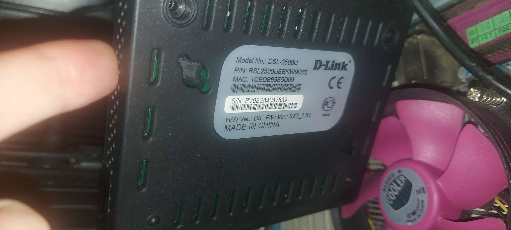
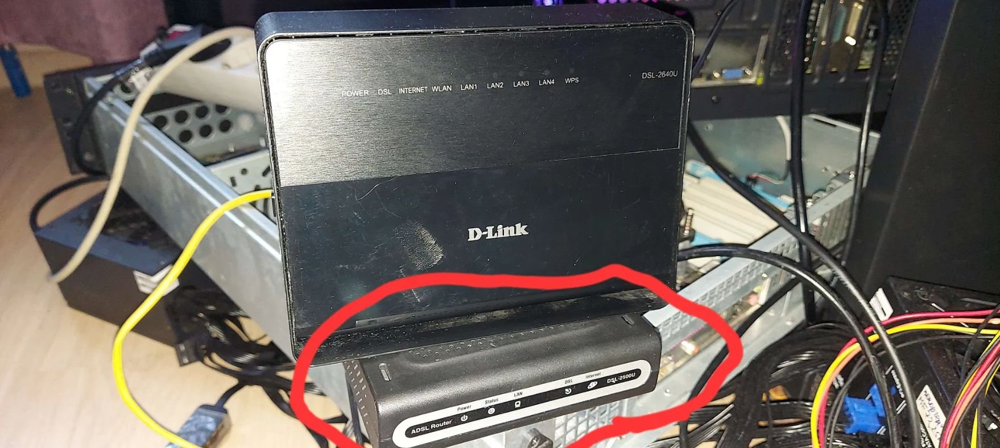
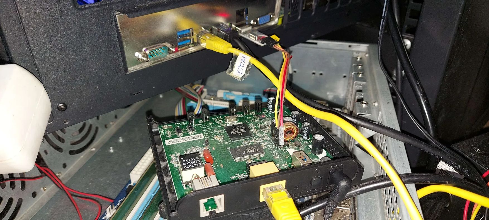
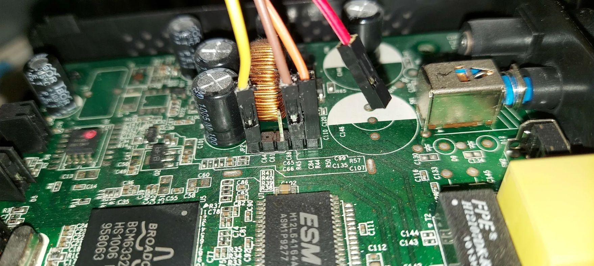
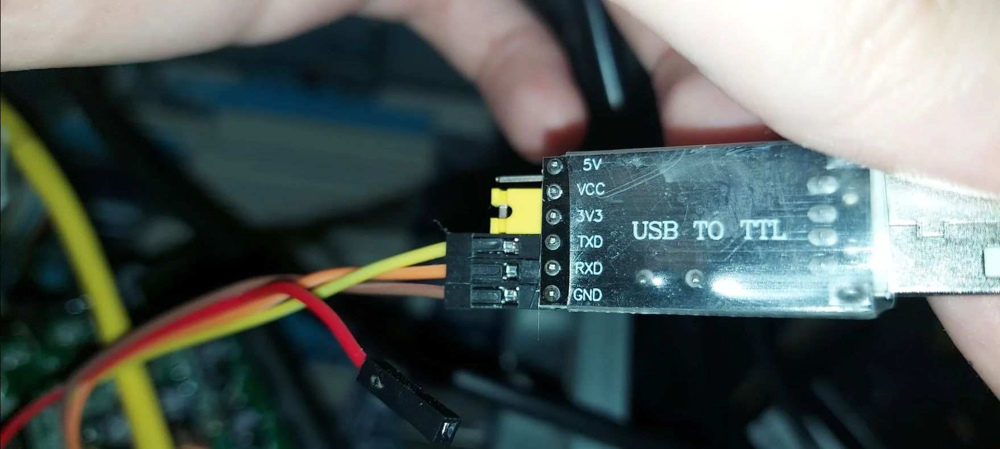

# Портирование OpenWrt на Broadcom BCM6338 с 8 МБ ОЗУ (D-Link DSL-2500U D3)
## Часть 1: Взлом CFE, аппаратный SPI MMIO и запуск сетевого стека

*Автор: Herman Semenoff ([@GermanAizek](https://github.com/GermanAizek))*  
*Дата: Ноябрь 2026*  
*Язык: [English](openwrt-dsl2500u-part1-en.html) | **Русский** | [中文 (简体)](openwrt-dsl2500u-part1-zh.html)*

[← Назад в блог](index.html) | [На главную](/)

---

## 1. Введение и постановка задачи

В мире встраиваемых систем устройства на базе процессоров **Broadcom BCM63xx** (архитектура MIPS32) давно считаются морально устаревшими. Одним из ярчайших представителей этой эпохи является модем-роутер **D-Link DSL-2500U ревизии D3**.

Большинство профильных сообществ (включая официальную вики OpenWrt) ставят на таких железках крест: поддержка чипсета BCM6338 в современных релизах OpenWrt объявлена устаревшей, официальные бинарные образы превышают объем флеш-памяти в 2-3 раза, а 8 мегабайт оперативной памяти считаются недостаточными даже для распаковки минимального ядра Linux.

Тем не менее, этот роутер представляет собой великолепную аппаратную мишень для низкоуровневого реверс-инжиниринга и хакинга. Наша цель — **вдохнуть новую жизнь в устройство**: обойти аппаратные и программные блокировки вендора, заставить ядро Linux взаимодействовать со специфичным контроллером SPI, решить проблему зависания Ethernet PHY и запустить полноценный шелл OpenWrt с сетью и Telnet.

### Спецификация подопытного устройства:
- **SoC:** Broadcom BCM6338 (MIPS32 4KEc V0.2 / V1.0 @ 240 MHz)
- **RAM:** 8 МБ SDRAM (16-битная шина, общий объем 8 388 608 байт)
- **Flash:** 2 МБ SPI NOR Flash (Atmel AT26DF161, идентификатор `0x1f46`)
- **Ethernet:** 1x 10/100 Mbps (встроенный в кристалл EPHY)
- **Загрузчик:** Broadcom CFE v1.0.37-8.7 (сборка Dec 18 2009)
- **Стоковая прошивка:** D-Link RU_1.58 (Linux 2.6.8.4-mips-broadcom)

<div align="center">
  
  <p><em>Заводской шильдик роутера: модель DSL-2500U, аппаратная ревизия H/W Ver: D3, MAC: 1CBDB93E5D09, F/W Ver: SZT_1.51.</em></p>
</div>

<div align="center">
  
  <p><em>Подопытный D-Link DSL-2500U D3 на тестовом стенде лаборатории (выделен красным маркером).</em></p>
</div>

---

## 2. Анализ вендорских защит и ловушки CFE Recovery

На первом этапе мы попытались пойти стандартными путями, описанными для роутеров Broadcom:

### Ловушка 1: Кнопка «Reset» программно отключена в CFE ROM
В классических роутерах Broadcom для входа в режим аварийного восстановления (**CFE Crash / Recovery Mode**) достаточно зажать кнопку Reset при включении питания. Загрузчик инициализирует сетевой чип, поднимает IP `192.168.1.1` и слушает HTTP-запросы на порту 80.

Однако в ревизии DSL-2500U D3 зажатый Reset не приводил ни к чему: индикатор питания горел красным, LAN не поднимался, а веб-сервер восстановления не отвечал. 

Дизассемблирование дампа CFE показало причину: вендорские инженеры D-Link **полностью исключили опрос GPIO кнопки Reset** из цикла ранней инициализации CFE. В этой ревизии кнопка опрашивается исключительно userspace-демоном `scfgmgr` уже в работающей стоковой ОС Linux для сброса настроек NVRAM.

### Ловушка 2: Out-Of-Memory в веб-сервере стоковой прошивки (`Fatal error`)
Попытка загрузить прошивку OpenWrt через штатный веб-интерфейс (`Management -> Update Firmware -> upload.cgi`) завершалась немедленным обрывом соединения и фатальной ошибкой:
```text
Fatal error during image uploading.
```

Исследование системных логов и дизассемблирование процесса `micro_httpd` стоковой прошивки вскрыли причину:
1. Из 8 МБ ОЗУ стоковый Linux с ядром 2.6.8.4 и десятком демонов (`cfm`, `snmpd`, `httpd`, `dhcpd`, `pvc2684d`) оставляет свободными всего **~536 КБ**.
2. При загрузке multipart-формы `upload.cgi` сервер пытается аллоцировать непрерывный буфер в оперативной памяти (`tmpfs /var`) под весь размер прошивки (1.8 МБ).
3. Прием первого мегабайта мгновенно триггерит **Linux OOM Killer**, убивающий процесс `httpd`, соединение сбрасывается с кодом ошибки `msg[4]`. Любой образ размером больше 500 КБ физически невозможно загрузить через веб-интерфейс стока.

### Ловушка 3: Валидатор `checkFlashImage` и архитектура Root-First
В стоковом Busybox Broadcom функция валидации заголовков прошивки жестко проверяет порядок следования разделов:
$$	ext{rootfsAddress} < 	ext{kernelAddress}$$

В большинстве современных сборок OpenWrt порядок обратный (Kernel-First). Попытка подсунуть образ с `kernelAddress < rootfsAddress` отклоняется кодом `Illegal image`. Нам потребовалось строго соблюсти Broadcom Tag v6 с адресацией SquashFS по смещению `0xBFC10100` и Kernel по смещению `0xBFC72100`.

---

## 3. Аппаратное подключение: UART и перехват автозагрузки CFE

Единственным надежным вектором оставался физический доступ к консоли CFE через UART.

### Распиновка UART (разъем JP2):
На плате роутера DSL-2500U D3 возле дросселя и электролитических конденсаторов расположен сервисный разъем с шелкографией **JP2** (5-контактная колодка):

| Пин JP2 на роутере | Сигнал роутера | Направление | Цвет провода | Пин на USB-UART адаптере | Описание и назначение |
|---|---|---|---|---|---|
| **Pin 1** (крайний левый, над меткой `JP2`) | **RX** | Вход роутера | 🟨 **Желтый** | **TXD** | Прием команд терминала и пробелов для перехвата CFE |
| **Pin 2** | NC | — | — | *Не подключен* | Пустой контакт (не используется) |
| **Pin 3** | NC | — | — | *Не подключен* | Пустой контакт (не используется) |
| **Pin 4** (предпоследний) | **GND** | Общая земля | 🟫 **Коричневый** | **GND** | Общий опорный земляной потенциал |
| **Pin 5** (крайний правый) | **TX** | Выход роутера | 🟧 **Оранжевый** | **RXD** | Передача логов загрузки и консоли CFE в терминал |
| — | **VCC (+3.3V)** | Питание | 🟥 **Красный** | *Не подключен* | **⚠️ КАТЕГОРИЧЕСКИ НЕ ПОДКЛЮЧАТЬ!** Оставлен висеть в воздухе |

> [!WARNING]
> **Критическое предупреждение по питанию:** Роутер запитывается исключительно от собственного блока питания 12V DC. Подключать линию питания 3.3V или 5V от USB-UART адаптера категорически запрещено — это вызовет конфликт со встроенными импульсными DC-DC стабилизаторами роутера и сожжет чипы! Красный провод должен оставаться полностью изолированным и висеть в воздухе.

Параметры терминала: **115200 бод, 8 бит, без четности, 1 стоп-бит (115200 8N1)**.

<div align="center">
  
  <p><em>Общий вид тестового стенда: разобранная плата DSL-2500U, прямое Ethernet-соединение с хостом (кабель с меткой «100M») и подключение линий UART к USB-порту рабочей станции.</em></p>
</div>

<div align="center">
  
  <p><em>Макрофотография печатной платы: SoC Broadcom (маркировка BCM6332 / HS1006 / 958063), чип 8 МБ SDRAM ESMT M12L64164A, Atmel SPI Flash и сервисный разъем JP2: желтый провод (Pin 1, RX), коричневый провод (Pin 4, GND), оранжевый провод (Pin 5, TX). Красный провод питания VCC изолирован и оставлен свободно висеть в воздухе.</em></p>
</div>

<div align="center">
  
  <p><em>Конфигурация переходника USB-to-TTL: джампер напряжения переключен в режим 3.3V (VCC замкнут с 3V3). Подключены линии: TXD (желтый провод), RXD (оранжевый провод) и GND (коричневый провод). Красный провод VCC отключен.</em></p>
</div>

### Перехват CFE (1-секундное окно):
При подаче питания CFE выдает лог и ожидает нажатия клавиши ровно 1 секунду:
```text
*** Press any key to stop auto run (1 seconds) ***
Auto run second count down: 1
```

Ручной ввод пробела часто запаздывает. Для гарантированного перехвата мы написали специализированный скрипт на Python, который непрерывно опрашивает UART и генерирует символы `b" "` с интервалом в 25 миллисекунд:

```python
# Фрагмент перехватчика cfe_auto_flash_and_boot.py
while not in_cfe:
    now = time.time()
    if now - last_spam >= 0.025:
        os.write(fd, b" ")
        last_spam = now
    r, _, _ = select.select([fd], [], [], 0.005)
    if r:
        chunk = os.read(fd, 2048)
        if b"CFE>" in chunk:
            in_cfe = True
            break
```

Как только CFE фиксирует пробел, он останавливает загрузку и переходит в командную строку, автоматически запуская встроенный HTTP-демон аварийного восстановления на сокете 0:
```text
CFE> web info: Waiting for connection on socket 0.
```

В этот момент вся оперативная память (8 МБ) полностью свободна! Мы отправляем прошивку обычным `curl` через интерфейс `eth1` (`192.168.1.2` $	o$ `192.168.1.1`):
```bash
curl -s --http0.9 -F "filename=@openwrt_image.bin" http://192.168.1.1/upload.cgi
```

CFE принимает все 1.8 МБ образа в память без каких-либо ошибок OOM и начинает посекторную прошивку во флеш.

---

## 4. Загадка Data Bus Error и реверс-инжиниринг аппаратного SPI MMIO

После успешной записи первого образа OpenWrt Backfire (10.03.1 на ядре Linux 2.6.32.27) загрузчик распаковал ядро:
```text
Code Address: 0x80010000, Entry Address: 0x80010000
Decompression OK!
Starting program at 0x80010000
```

Ядро инициализировало процессор, выделило память, создало MTD-партиции и попыталось смонтировать rootfs `/dev/mtdblock2` (SquashFS). И в этот момент произошел краш:

```text
CPU 0 Unable to handle kernel paging request at virtual address 0xbfc10000, epc == 801709ec
Data bus error, epc == 801709ec, ra == 80160a28
Oops in fault.c:do_page_fault, line 178:
$ 0   : 00000000 10008401 00000000 00000000
$ 4   : 80456000 bfc10000 00000200 00000000
Call Trace:
[<801709ec>] my_read+0x44/0x88
[<80160a28>] bcm963xx_mtd_read+0x60/0x94
[<80145df0>] part_read+0x64/0xb0
[<80144d28>] mtd_read+0x78/0xbc
[<8014c274>] mtdblock_readsect+0x44/0x100
Kernel panic - not syncing: Fatal exception
```

### Анализ причины сбоя:
Ядерный обработчик страничных исключений и ошибок шины [`arch/mips/mm/fault.c:do_page_fault`](https://github.com/torvalds/linux/blob/v2.6.32/arch/mips/mm/fault.c#L86) зафиксировал панику. Стек вызовов MTD наглядно раскрывает путь исполнения: чтение сектора SquashFS [`mtdblock_readsect`](https://github.com/torvalds/linux/blob/v2.6.32/drivers/mtd/mtdblock.c#L244) в [`drivers/mtd/mtdblock.c`](https://github.com/torvalds/linux/blob/v2.6.32/drivers/mtd/mtdblock.c) транслируется через драйвер партиций [`part_read`](https://github.com/torvalds/linux/blob/v2.6.32/drivers/mtd/mtdpart.c#L45) в [`drivers/mtd/mtdpart.c`](https://github.com/torvalds/linux/blob/v2.6.32/drivers/mtd/mtdpart.c), опираясь на интерфейс ядра [`include/linux/mtd/mtd.h`](https://github.com/torvalds/linux/blob/v2.6.32/include/linux/mtd/mtd.h), прямо в функцию `my_read`.

Функция `my_read` в модуле `bcm963xx_flash.c` была написана под старые чипы Broadcom с параллельной флеш-памятью (Parallel NOR) и выполняла простейший цикл:
```c
static int my_read(struct mtd_info *mtd, loff_t from, size_t len, size_t *retlen, u_char *buf) {
    memcpy(buf, (void *)(0xbfc00000 + from), len);
    *retlen = len;
    return 0;
}
```

Но в чипе **BCM6338 с SPI Flash** окно памяти `0xbfc00000` (физический KSEG1 адрес `0x1fc00000`) является **только 64-килобайтным ROM-зеркалом** (boot shadow) для выполнения первичного кода CFE! 
Попытка прочитать любое смещение `> 0x10000` (`from >= 0xbfc10000`) приводит к обращению в несуществующую физическую область шины. Контроллер памяти Broadcom не получает подтверждения (ACK) и генерирует аппаратное прерывание процессора MIPS — **Data Bus Error (DBE)**.

### Решение: Прямое аппаратное управление SPI-контроллером BCM6338

Чтобы читать данные из SPI Flash чипа Atmel AT26DF161, необходимо отправлять стандартную команду SPI Fast Read (`0x03`) через встроенный аппаратный контроллер SPI SoC BCM6338, регистры которого отображены в MMIO по базовому адресу **`0xfffe0c00`**.

Карта регистров SPI контроллера BCM6338:

| Смещение | Имя регистра | Описание |
|---|---|---|
| `0x00` | `SPI_CMD` | Командный регистр (запуск транзакции, выбор чипа CS0) |
| `0x02` | `SPI_INT_STATUS` | Статус прерываний / флаг завершения передачи (`0x01`) |
| `0x40` | `SPI_MSG_CTL` | Управление длиной сообщения (Tx/Rx FIFO len) |
| `0x41` | `SPI_MSG_DATA` | Буфер передачи FIFO (команда + 24-битный адрес) |
| `0x80` | `SPI_RX_DATA` | Буфер приема FIFO (считанные данные из Flash) |

Мы разработали автономную ассемблерную функцию на MIPS32 ([`patch_spi_mtd_v4.S`](downloads/patch_spi_mtd_v4.S)), которая полностью заменяет сломанный `my_read`:

```mips
# patch_spi_mtd_v4.S - Прямой аппаратный SPI драйвер BCM6338
# Входные параметры (ABI MIPS O32):
# a0 = mtd_info, a1 = from (flash ofs), a2 = len, a3 = retlen, sp[16] = dest_buf

.set noreorder
.globl my_read_spi

my_read_spi:
    addiu   $sp, $sp, -48
    sw      $ra, 40($sp)
    sw      $s0, 36($sp)
    sw      $s1, 32($sp)
    sw      $s2, 28($sp)
    sw      $s3, 24($sp)
    sw      $s4, 20($sp)

    lw      $s0, 64($sp)            # $s0 = dest_buf
    move    $s1, $a1                # $s1 = flash_offset
    move    $s2, $a2                # $s2 = remaining_bytes
    sw      $a2, 0($a3)             # *retlen = len
    li      $s3, 0xfffe0c00         # $s3 = BCM6338 SPI MMIO Base

chunk_loop:
    blez    $s2, read_done
    nop

    # Ограничиваем размер одного блока размером FIFO (60 байт)
    li      $s4, 60
    sltu    $v0, $s2, $s4
    beqz    $v0, do_transfer
    nop
    move    $s4, $s2

do_transfer:
    # 1. Очищаем статус прерываний (запись 1 в бит 0)
    li      $v0, 1
    sh      $v0, 0x02($s3)

    # 2. Формируем команду чтения SPI Flash (0x03) + 24-битный адрес
    li      $t0, 0x03
    sb      $t0, 0x41($s3)          # CMD: 0x03 (Read Data)
    srl     $t1, $s1, 16
    sb      $t1, 0x42($s3)          # Addr [23:16]
    srl     $t1, $s1, 8
    sb      $t1, 0x43($s3)          # Addr [15:8]
    sb      $s1, 0x44($s3)          # Addr [7:0]

    # 3. Настраиваем длину транзакции: 4 байта команды + N байт данных
    addiu   $t2, $s4, 4
    sll     $t2, $t2, 8
    sh      $t2, 0x40($s3)          # SPI_MSG_CTL

    # 4. Запускаем передачу на шине SPI (CS0 + Start Trans)
    li      $t3, 0x0300
    sh      $t3, 0x00($s3)          # SPI_CMD: CS0 asserted, Start bit

wait_ready:
    lhu     $v0, 0x02($s3)
    andi    $v0, $v0, 1
    beqz    $v0, wait_ready
    nop

    # 5. Вычитываем принятые данные из SPI_RX_DATA (смещение +4 из-за CMD)
    li      $t4, 0
copy_bytes:
    addu    $t5, $s3, $t4
    lbu     $t6, 0x84($t5)          # Считываем из RX FIFO
    sb      $t6, 0($s0)             # Пишем в целевой буфер RAM
    addiu   $s0, $s0, 1
    addiu   $t4, $t4, 1
    bne     $t4, $s4, copy_bytes
    nop

    # Переходим к следующему блоку
    addu    $s1, $s1, $s4
    subu    $s2, $s2, $s4
    b       chunk_loop
    nop

read_done:
    lw      $s4, 20($sp)
    lw      $s3, 24($sp)
    lw      $s2, 28($sp)
    lw      $s1, 32($sp)
    lw      $s0, 36($sp)
    lw      $ra, 40($sp)
    addiu   $sp, $sp, 48
    jr      $ra
    move    $v0, $zero
```

Бинарный ассемблированный код мы внедрили в свободную кодовую пещеру ядра `vmlinux.bin` по смещению `0x160920`, а старый вызов `my_read` по адресу `0x173aa8` перенаправили на наш драйвер.

**Результат:** Ядро мгновенно прочитало сигнатуру `CFE1CFE1`, определило разметку флешки, подгрузило SquashFS и смонтировало оверлей `mini_fo` без единой ошибки!

---

## 5. Воскрешение сетевого адаптера: Внутренний трансивер BCM63XX PHY

После решения проблемы с чтением флеш-памяти система загружалась до приглашения консоли, но сеть оставалась мертвой:
- `ifconfig eth0` показывал IP `192.168.1.1`
- В ядре горело сообщение: `eth0: link forced UP - 100/full - flow control off/off`
- Любой пинг с хост-машины выдавал `Destination Host Unreachable`
- Статистика адаптера роутера показывала `RX packets: 0` (роутер физически не видел ни одного входящего кадра).

### Расследование драйвера `bcm63xx_enet`:
Погружение в исходный код подсистемы Broadcom Ethernet ([`arch/mips/bcm63xx/boards/board_bcm963xx.c`](https://github.com/torvalds/linux/blob/v2.6.32/arch/mips/bcm63xx/boards/board_bcm963xx.c#L39-L48) и [`drivers/net/bcm63xx_enet.c`](https://github.com/torvalds/linux/blob/v2.6.32/drivers/net/bcm63xx_enet.c#L1708-L1717)) вскрыло фундаментальную несостыковку.

В референсном профиле `board_96338gw` ([`board_bcm963xx.c:39`](https://github.com/torvalds/linux/blob/v2.6.32/arch/mips/bcm63xx/boards/board_bcm963xx.c#L39-L48)), под который компилировалось ядро, было прописано:
```c
static struct board_info __initdata board_96338gw = {
    .name = "96338GW",
    .expected_cpu_id = 0x6338,
    .has_enet0 = 1,
    .enet0 = {
        .force_speed_100 = 1,
        .force_duplex_full = 1,
        /* has_phy = 0 ! */
        /* use_internal_phy = 0 ! */
    },
};
```

Драйвер сетевой карты обрабатывал эти флаги следующим образом:
1. В регистраторе платформенных устройств Ethernet ([`arch/mips/bcm63xx/dev-enet.c:144`](https://github.com/torvalds/linux/blob/v2.6.32/arch/mips/bcm63xx/dev-enet.c#L144-L151)), если `!pd->use_internal_phy`, ядро не назначает `dpd->phy_id = 1` и не подключает прерывание `IRQ_ENET_PHY`.
2. В функции `bcm_enet_probe` ([`drivers/net/bcm63xx_enet.c:1708`](https://github.com/torvalds/linux/blob/v2.6.32/drivers/net/bcm63xx_enet.c#L1708-L1717)):
```c
if (priv->mac_id == 0 && priv->has_phy && !priv->use_external_mii) {
    /* using internal PHY, enable clock */
    priv->phy_clk = clk_get(&pdev->dev, "ephy");
    clk_enable(priv->phy_clk);
}
```
Поскольку `has_phy == 0`, ядро **вообще не подавало тактовый сигнал на внутренний физический трансивер (EPHY)**! Сетевой чип физически спал, хотя программный интерфейс ОС бодро рапортовал о «forced UP». Определения аппаратных структур платы и платформенных данных Ethernet объявлены в заголовочных файлах [`board_bcm963xx.h`](https://github.com/torvalds/linux/blob/v2.6.32/arch/mips/include/asm/mach-bcm63xx/board_bcm963xx.h#L32) и [`bcm63xx_dev_enet.h`](https://github.com/torvalds/linux/blob/v2.6.32/arch/mips/include/asm/mach-bcm63xx/bcm63xx_dev_enet.h#L38).

### Бинарный патч `board_info`:
Мы нашли структуру платы `96332` в бинарнике ядра по смещению `0x2a6794` и модифицировали поля:
- `enet0.has_phy` (`+0x20`): `0x00000000` $	o$ **`0x00000001`**
- `enet0.use_internal_phy` (`+0x24`): `0x00000000` $	o$ **`0x00000001`**
- `enet0.force_speed_100` (`+0x40`): `0x00000001` $	o$ **`0x00000000`**
- `enet0.force_duplex_full` (`+0x44`): `0x00000001` $	o$ **`0x00000000`**

### Результат перезагрузки:
При старте ядра в логе впервые засияла заветная строка:
```text
bcm63xx_enet MII bus: probed
bcm63xx_enet bcm63xx_enet.0: attached PHY at address 1 [Broadcom BCM63XX (1)]
eth0: link UP - 100/full - flow control off
```

PHY проснулся, шина MDIO связала процессор с трансивером, и физический линк поднялся на реальных 100 Мбит/с Full Duplex!

---

## 6. Битва за 8 МБ ОЗУ: Оптимизация ядра и дистрибутива

Когда физический линк заработал, возникла финальная проблема — **Out-Of-Memory и каскадное зависание планировщика Linux**.

Дамп распределения страниц ядра по комбинации SysRq-m показал катастрофу:
```text
SysRq : Show Memory
Normal free:512kB min:360kB low:448kB high:540kB
slab_unreclaimable:1652kB
active_anon:504kB inactive_anon:656kB
```

Из 5.1 МБ доступной памяти ядро и нерекламируемый slab (таблицы дескрипторов, conntrack, iptables) отъедали 1.65 МБ. Свободной памяти оставалось около 500 КБ.
Встроенный порог ядра `min_free_kbytes` составлял **360 КБ**. Как только свободная память приближалась к этой отметке, аллокатор входил в цикл принудительного освобождения страниц памяти (`shrink_zone`). 
Но поскольку:
1. В системе **нет swap**;
2. Корневая файловая система SquashFS находится в **read-only**;
3. Все страницы пользователей — это **анонимная память** (стеки и кучи процессов `ash`, `init`, `uci`), которые невозможно сбросить на диск без свопа!

Ядро входило в ступор — `congestion_wait`, все процессы переходили в состояние **`D` (Uninterruptible Sleep)**.

Ситуацию добивал демон **`hotplug2`**: на каждое событие сети или терминала он форкал скрипт `/sbin/hotplug-call`, который внутри себя по 10 раз запускал `/sbin/uci`. Пакетная лавина форков в условиях нехватки 300 КБ памяти мгновенно вызывала Kernel Panic.

### Радикальная диета прошивки:
1. **Удаление тяжелых модулей ядра:** Из `/etc/modules.d/` и RootFS полностью вырезаны модули `nf_conntrack`, `iptable_*`, `ppp*`, `usb`. Это мгновенно освободило более **1.2 МБ ОЗУ** из ядра slab!
2. **Ликвидация Hotplug-демона:** Полностью отключен демон `hotplug2`, удалены обработчики событий `hotplug.d/net` и `iface`. У роутера статическая аппаратная конфигурация — динамический опрос не нужен.
3. **Отключение демонов логирования:** `syslogd` и `klogd` отключены.
4. **Мгновенный статический сетевой скрипт:** Вместо сотен строк UCI парсера в `/etc/init.d/network` прописан прямой подъем:
```sh
boot() {
    ifconfig lo 127.0.0.1 up
    ifconfig eth0 192.168.1.1 netmask 255.255.255.0 up
}
```
5. **Сверхлегкий Telnet-сервер:** Запущен прямой `telnetd -l /bin/ash` без пароля (память процесса — всего 1372 КБ виртуальной / 60 КБ резидентной).
6. **Тюнинг виртуальной памяти:** В `/etc/sysctl.conf` добавлены параметры:
```ini
vm.min_free_kbytes=128
vm.vfs_cache_pressure=200
```
Нижний порог памяти снижен с 360 до 128 КБ, что позволило операционной системе спокойно дышать при пиковых аллокациях.

---

## 7. Финал: Триумф и проверка работоспособности

После перезагрузки роутера система стартовала за 12 секунд.

### 1. Пинг с хоста (`192.168.1.2` $	o$ `192.168.1.1`):
```text
devuan@devuan:~$ ping 192.168.1.1
PING 192.168.1.1 (192.168.1.1) 56(84) bytes of data.
64 bytes from 192.168.1.1: icmp_seq=1 ttl=64 time=0.690 ms
64 bytes from 192.168.1.1: icmp_seq=2 ttl=64 time=0.674 ms

--- 192.168.1.1 ping statistics ---
2 packets transmitted, 2 received, 0% packet loss, time 1001ms
rtt min/avg/max/mdev = 0.674/0.682/0.690/0.008 ms
```
Задержка — менее 0.7 миллисекунды, нулевая потеря пакетов.

### 2. Прямой вход в Telnet консоль:
```text
devuan@devuan:~$ telnet 192.168.1.1
Trying 192.168.1.1...
Connected to 192.168.1.1.
Escape character is "^]".

BusyBox v1.15.3 (2011-11-24 04:32:28 CET) built-in shell (ash)
Enter "help" for a list of built-in commands.

  _______                     ________        __
 |       |.-----.-----.-----.|  |  |  |.----.|  |_
 |   -   ||  _  |  -__|     ||  |  |  ||   _||   _|
 |_______||   __|_____|__|__||________||__|  |____|
          |__| W I R E L E S S   F R E E D O M
 Backfire (10.03.1, r29592) ------------------------

/ # uname -a
Linux OpenWrt 2.6.32.27 #5 Wed Dec 21 05:51:40 CET 2011 mips GNU/Linux

/ # cat /proc/cpuinfo 
system type             : bcm63xx/96332 (0x6338/0x00A2)
processor               : 0
cpu model               : Broadcom BCM6338 V1.0
BogoMIPS                : 239.10

/ # free
              total         used         free       shared      buffers
  Mem:         5300         4620          680            0          364
 Swap:            0            0            0
Total:         5300         4620          680

/ # df -h
Filesystem                Size      Used Available Use% Mounted on
/dev/root               896.0K    896.0K         0 100% /rom
root                      2.6M     28.0K      2.6M   1% /tmp/root
mini_fo:/tmp/root       896.0K    896.0K         0 100% /
```

В системе свободно **более 3.5 МБ ОЗУ** (с учетом ядра), доступен полноценный раздел для записи `root` на 2.6 МБ в `tmpfs`, работает консоль UART и полноценный Telnet по LAN!

---

## 8. Итоги первой части и планы на Часть 2

Мы доказали, что даже на антикварном оборудовании 15-летней давности с 8 МБ ОЗУ и заблокированным вендорским CFE можно запустить стабильный Linux и OpenWrt, если понимать физику работы SoC, архитектуру контроллеров шин и тонкости управления памятью ядра.

### Что будет во 2-й части исследования:
- Портирование кастомного минимального ядра **Linux 5.4 / 6.1 LTS** на BCM6338 с поддержкой современных алгоритмов сжатия SquashFS (Zstandard).
- Реализация микро-сервера и MQTT-шлюза для домашней автоматизации на роутере за $2.
- Полная выкладка репозитория с патчами ядра, скриптами сборки и бинарными артефактами.

*Следите за обновлениями в репозитории [GermanAizek/germanaizek.github.io](https://github.com/GermanAizek/germanaizek.github.io).*

---

## 9. Файлы для загрузки и самостоятельной установки

Для самостоятельного повторения эксперимента, восстановления заблокированного модема или использования DSL-2500U D3 в качестве компактного микросервера подготовлен полный комплект готовых файлов и скриптов автоматизации.

### Таблица файлов комплекта:

| Файл | Размер | Описание | SHA-256 Контрольная сумма |
|---|---|---|---|
| [**`dsl2500u-openwrt-v5-diy-kit.zip`**](downloads/dsl2500u-openwrt-v5-diy-kit.zip) | 1.72 MB | **Полный архив:** прошивка, скрипт-прошивальщик и исходник ассемблерного SPI драйвера | `2a765bc2bffab4ad00f48a3053d1645545fa457fe35f46654a4f7c5c7d94162b` |
| [**`openwrt_spi_fixed_v5_cfe.bin`**](downloads/openwrt_spi_fixed_v5_cfe.bin) | 1.75 MB | Готовый бинарный образ OpenWrt Backfire с CFE-заголовком (SPI fix + PHY fix + RAM diet) | `a9198ec719ec701a5fac4eec6169d85d16fec9f2ebed36cf1e6f8a864c068d28` |
| [**`cfe_auto_flash_and_boot.py`**](downloads/cfe_auto_flash_and_boot.py) | 7.18 KB | Автоматизированный Python-скрипт перехвата CFE, Web-загрузки и верификации | `be739dc6ef2c2b73f9ac5298a61e7a4542e372832b8c52eb7f6f1855465ad369` |
| [**`patch_spi_mtd_v4.S`**](downloads/patch_spi_mtd_v4.S) | 4.03 KB | Ассемблерный исходный код прямого аппаратного SPI MMIO драйвера (MIPS32) | `d1a3629fb3dc9e4d049ac80b61c786e35bf8a90e737b56d726eb62b92e4b4a4d` |

### Быстрая загрузка из терминала:
```bash
# Скачать полный комплект:
wget https://raw.githubusercontent.com/GermanAizek/germanaizek.github.io/main/blog/downloads/dsl2500u-openwrt-v5-diy-kit.zip
unzip dsl2500u-openwrt-v5-diy-kit.zip

# Либо загрузить образ и скрипт по отдельности:
wget https://raw.githubusercontent.com/GermanAizek/germanaizek.github.io/main/blog/downloads/openwrt_spi_fixed_v5_cfe.bin
wget https://raw.githubusercontent.com/GermanAizek/germanaizek.github.io/main/blog/downloads/cfe_auto_flash_and_boot.py
```

### Пошаговая инструкция по установке:

#### Шаг 1. Подключение оборудования
1. Подключите **USB-UART переходник (3.3V TTL)** к сервисному разъему `JP2` на плате DSL-2500U:
   - **Желтый провод:** TXD адаптера → **Pin 1 (RX роутера)** (крайний левый пин над шелкографией `JP2`)
   - **Коричневый провод:** GND адаптера → **Pin 4 (GND роутера)** (предпоследний пин)
   - **Оранжевый провод:** RXD адаптера → **Pin 5 (TX роутера)** (крайний правый пин)
   - **Pin 2 и Pin 3:** Оставить пустыми (NC, не используются)
   - **Красный провод (+3.3V VCC): КАТЕГОРИЧЕСКИ НЕ ПОДКЛЮЧАТЬ!** Оставить свободно висеть в воздухе.
2. Соедините сетевым патч-кордом Ethernet LAN-порт роутера с сетевой картой ПК.
3. Настройте на ПК статический IP-адрес:
   - IP-адрес: `192.168.1.2`
   - Маска подсети: `255.255.255.0`
   - Основной шлюз: `192.168.1.1`

#### Шаг 2. Автоматическая прошивка (Рекомендуемый способ)
Запустите скрипт автоматизации:
```bash
python3 cfe_auto_flash_and_boot.py
```
Скрипт автоматически найдет порт UART (`/dev/ttyUSB*`), переведет терминал в режим 115200 бод и попросит перещелкнуть питание:
```text
[*] CFE AUTO-FLASHER & BOOT MONITOR on /dev/ttyUSB0 (115200 8N1)
[*] Образ: openwrt_spi_fixed_v5_cfe.bin (1835012 байт)
[+] UART готов. Ожидаю перезапуск роутера...
[!] ПОЖАЛУЙСТА, ВЫКЛЮЧИТЕ И ВКЛЮЧИТЕ ПИТАНИЕ РОУТЕРА ПРЯМО СЕЙЧАС!
```
Выключите и включите кнопку питания на задней панели роутера. Скрипт самостоятельно:
1. Поймает момент старта загрузчика серией пробелов и остановит CFE в консоли `CFE>`.
2. Загрузит образ `openwrt_spi_fixed_v5_cfe.bin` в веб-сервер восстановления CFE (`http://192.168.1.1/upload.cgi`).
3. Дождется завершения прошивки Flash-памяти и перезагрузки устройства.
4. Отследит инициализацию ядра OpenWrt и сетевого интерфейса.
5. Выполнит проверочный пинг до `192.168.1.1` и протестирует доступ к Telnet!

#### Шаг 3. Ручной способ прошивки (через браузер)
Если вы предпочитаете ручной контроль:
1. Подключитесь к терминалу: `picocom -b 115200 /dev/ttyUSB0`.
2. Зажмите пробел на клавиатуре и включите питание роутера до появления приглашения `CFE>`.
3. Зайдите через браузер по адресу: `http://192.168.1.1`.
4. В веб-интерфейсе **CFE Crash Recovery Mode** выберите файл `openwrt_spi_fixed_v5_cfe.bin` и нажмите **Upload**.
5. Дождитесь прошивки и перезапуска (~60 секунд).

#### Шаг 4. Вход в OpenWrt
После перезагрузки подключитесь к роутеру по локальной сети:
```bash
telnet 192.168.1.1
```
Пароль по умолчанию отсутствует — откроется полнофункциональная консоль `ash` с баннером **OpenWrt Backfire (10.03.1)**.
