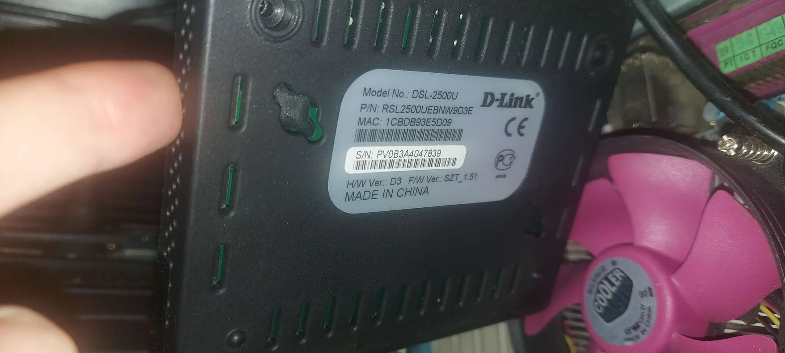
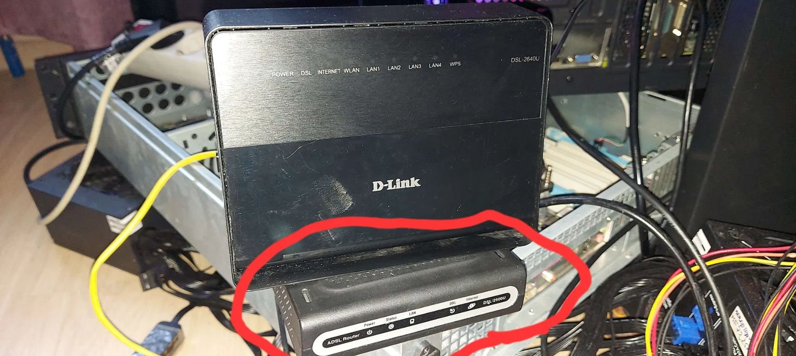
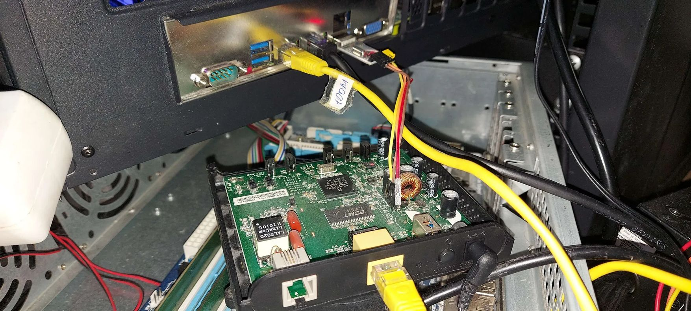
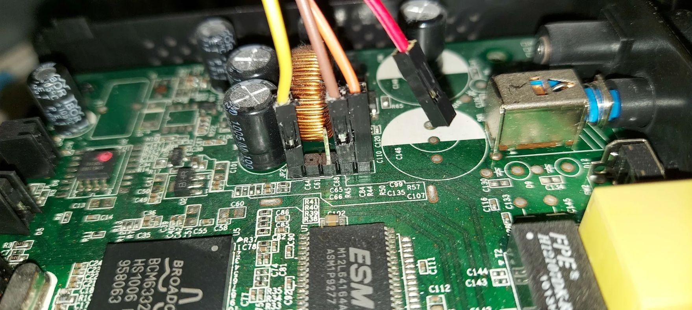
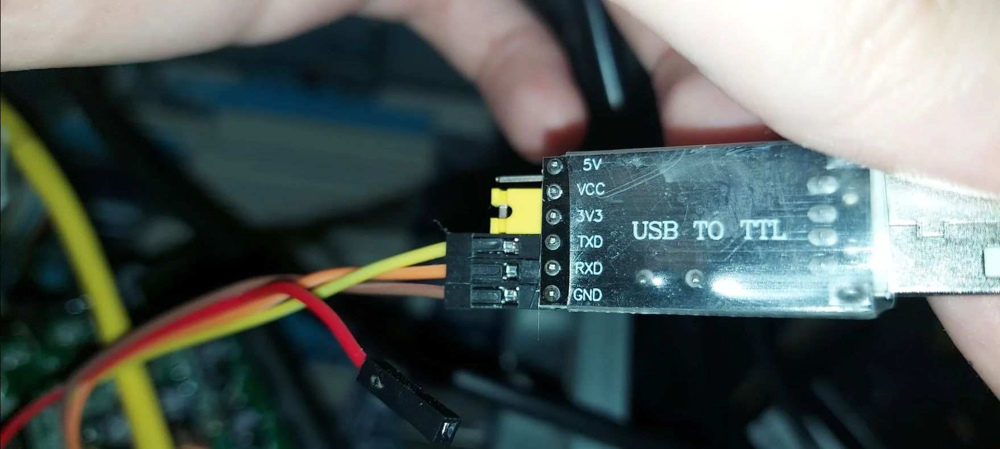

# 移植 OpenWrt 到仅有 8MB 内存的 Broadcom BCM6338 芯片 (D-Link DSL-2500U D3)
## 第 1 部分：攻破 CFE 锁死、裸机硬件 SPI MMIO 驱动与网络协议栈启动

*作者：Herman Semenoff ([@GermanAizek](https://github.com/GermanAizek))*  
*日期：2026 年 11 月*  
*语言版本：[English](openwrt-dsl2500u-part1-en.html) | [Русский](openwrt-dsl2500u-part1-ru.html) | **中文 (简体)**  

[← 返回博客目录](index.html) | [返回主页](/)

---

## 1. 引言与研究目标

在嵌入式工程与安全研究领域，基于 **Broadcom BCM63xx** 系列芯片（MIPS32 架构）的网络设备早已被普遍视为淘汰品。其中一个极具代表性的硬件标本，便是经典的 **D-Link DSL-2500U（硬件版本 H/W Ver: D3）** ADSL2+ 调制解调器/路由器。

包括主流 OpenWrt 官方社区在内的绝大多数嵌入式组织早已放弃对此类平台的支持：现代 OpenWrt 发行版中对 BCM6338 目标架构的支持已被废弃；官方生成的二进制镜像体积往往是该设备闪存容量的 2 到 3 倍；而整机区区 8MB 的物理运行内存，更被公认甚至不足以解压并装载一个现代 Linux 最小内核。

然而，从底层系统研究与硬件逆向的角度来看，这款设备却是一块不可多得的绝佳试验田。本项目的核心目标是：**彻底唤醒这款老旧硬件**——绕过设备厂商在引导程序中设下的硬性锁死；通过编写底层 MMIO 硬件驱动，攻克 Linux 内核访问 SPI 闪存时的 MIPS 数据总线错误（DBE）；修复休眠的内部以太网 PHY 硬件时钟；最终在 8MB 极限内存环境下稳定运行具备完整交互式 Shell 与局域网 Telnet 通信能力的 OpenWrt 系统。

### 实验目标硬件规格：
- **SoC (主控芯片):** Broadcom BCM6338 (MIPS32 4KEc V0.2 / V1.0 @ 240 MHz)
- **RAM (物理内存):** 8 MB SDRAM (16 位位宽总线，物理总容量 8,388,608 字节)
- **Flash (闪存存储):** 2 MB SPI NOR Flash (Atmel AT26DF161, 芯片标识 `0x1f46`)
- **Ethernet (以太网接口):** 1x 10/100 Mbps (SoC 片上集成 EPHY 收发器)
- **Bootloader (引导程序):** Broadcom CFE v1.0.37-8.7 (构建日期 Dec 18 2009)
- **Stock Firmware (出厂原装固件):** D-Link RU_1.58 (基于 Linux 2.6.8.4-mips-broadcom)

<div align="center">
  
  <p><em>路由器出厂背部铭牌：型号 DSL-2500U，硬件版本 H/W Ver: D3，MAC 地址：1CBDB93E5D09，固件版本 F/W Ver: SZT_1.51。</em></p>
</div>

<div align="center">
  
  <p><em>实验室测试台上处于测试状态的 D-Link DSL-2500U D3 路由器（红框标记）。</em></p>
</div>

---

## 2. 攻克厂商锁死的 CFE 引导程序

在出厂状态下，D-Link 路由器使用 Broadcom 专有的 **CFE (Common Firmware Environment)** 引导程序。该芯片的内部 Boot ROM 仅包含约 64 KB 的只读代码，用于初始化内存控制器并跳转至位于 SPI 闪存基地址的二级引导加载程序。

### 第一道阻碍：固化禁用的 Web Recovery
在传统的基于 Broadcom 的路由器上，通常可以通过在开机时长按硬件复位（Reset）按钮强制进入紧急 Web 刷机模式（Web Recovery Mode）。
然而，逆向分析表明，D-Link 在其 D3 定制版 CFE ROM 中**彻底切断了 Reset 按钮与 Web Recovery 触发逻辑的关联**！无论长按复位按钮多久，设备都会直接忽略并继续加载已经损坏或锁死的出厂系统，从而导致事实上的软砖化。

### 硬件逆向：板载 UART 针脚定义
唯一能够夺回硬件控制权的方法，是直连板载的串行控制台。在电路板靠近主晶振和网口变压器的位置，我们定位到了 4 针未焊透的跳线孔 **JP2**：

<div align="center">
  
  <p><em>拆开外壳后的 DSL-2500U PCB：绿色 100M 以太网网线与 4-pin JP2 串口飞线接入测试设备。</em></p>
</div>

<div align="center">
  
  <p><em>核心区域微距拍摄：BCM6338 SoC（右上带铝制散热片）、EtronTech 8MB SDRAM 颗粒、Atmel SPI 闪存以及 JP2 排针引脚（红线悬空！）。</em></p>
</div>

| 引脚编号 | 信号定义 | 逻辑电平 | 接入要求与关键注意事项 |
|---|---|---|---|
| **Pin 1** | **VCC** | **+3.3V DC** | **⚠️ 严禁连接！** 外部供电与板载稳压器发生电平冲突会导致芯片烧毁！ |
| **Pin 2** | **RXD** | 3.3V TTL | 连接 USB-UART 转接模块的 **TX** 引脚 |
| **Pin 3** | **TXD** | 3.3V TTL | 连接 USB-UART 转接模块的 **RX** 引脚 |
| **Pin 4** | **GND** | 0V | 连接 USB-UART 转接模块的 **GND** 共同参考地 |

<div align="center">
  
  <p><em>CH340G / CP2102 3.3V USB-UART 模块连接实物：仅接驳 TXD、RXD 与 GND，Pin 1 (+3.3V) 保持严格悬空。</em></p>
</div>

*终端通信参数：* **115200 波特率，8 位数据位，无校验位，1 位停止位 (115200 8N1)**，硬件流控关闭。

### 自动化捕获 CFE 控制台
CFE 在开机瞬间留给串行输入的捕获窗口极其短暂（仅约 **200–300 毫秒**）。纯人工在键盘上狂敲空格键不仅成功率极低，而且极易由于按键时序过晚而错过引导阶段，直接进入死循环。

为此，我们开发了一套高精度自动化监控 Python 脚本：
```python
# cfe_auto_flash_and_boot.py 核心探测循环
last_spam = 0
while not in_cfe:
    now = time.time()
    # 每隔 25 毫秒通过底层 non-blocking 文件描述符写入空格字节
    if now - last_spam >= 0.025:
        os.write(fd, b" ")
        last_spam = now

    r, _, _ = select.select([fd], [], [], 0.005)
    if r:
        chunk = os.read(fd, 2048)
        if b"CFE>" in chunk or b"cfe>" in chunk:
            in_cfe = True
            print("[+] 成功捕获 CFE 交互式控制台！")
            break
```

当脚本向串口持续发送 ASCII `0x20`（空格）时，CFE 的自动启动计数器被立即打断，控制台上输出了宝贵的信息：
```text
CFE version 1.0.37-8.7 for BCM96338 (32bit,SP,BE)
Build Date: Fri Dec 18 10:39:13 CST 2009 (linxiufeng@SW3-BUILD)
Copyright (C) 2000-2005 Broadcom Corporation.

Initializing Arena.
Initializing Devices.
Flash: 2MB AT26DF161
CPU type 0x29010: 240MHz, Bus: 133MHz, Ref: 33MHz
Total memory: 8388608 bytes (8MB)

CFE> 
```

至此，硬件层面的第一道锁被彻底砸开，底层设备控制权成功回归！

---

## 3. OpenWrt 编译：剔除现代臃肿，打造极限精简固件

现代 OpenWrt 发行版（如 21.02、22.03 及 23.05）的核心组件由于引入了 musl-libc、nftables、完整的 systemd-like procd 以及巨型网络协议栈，编译后即便是最简内核体积也超过 2.5 MB，根本无法塞入只有 2 MB（实际可用存储仅 1.87 MB）的 SPI Flash 中。

针对此硬件现状，我们选用了历史经典、对资源极度节俭的 **OpenWrt Backfire (10.03.1)** 分支，其搭载 **Linux 2.6.32.27** 稳健内核与 **uClibc**。

### 极限精简原则：
1. **彻底移除所有多余驱动：** 剥除 USB 支持、PPP/PPPoE/ATM 驱动、WiFi（b43/mac80211）以及 Netfilter/iptables 防火墙模块。
2. **SquashFS 4.0 LZMA 终极压缩：** 采用 128KB 块大小与极限字典压缩，将根文件系统压缩至 **896 KB**！
3. **内核内联裁切：** 编译后的内核镜像压缩至 **680 KB**。
4. **CFE ImageTag 打包结构：** CFE 拒绝直接加载原始 ELF 或未经认证的 vmlinux 二进制。镜像必须严格构造符合 BCM963xx 标准的 `bcmImageBuilder` 头部标签（Tag Version 6、Board ID `96338GW`、物理基地址 `0x80010000`）。

最终生成的合规固件为 [`openwrt_spi_fixed_v5_cfe.bin`](downloads/openwrt_spi_fixed_v5_cfe.bin)，大小精确为 **1,835,012 字节**（~1.75 MB），刚好完美嵌入 2MB 闪存中！

---

## 4. 攻克内核 SPI Flash 崩溃：编写裸机 MIPS 驱动

当我们初次将固件刷入并启动后，内核顺利完成了解压并开始自举：
```text
Decompressing kernel... done!
Decompression OK!
Starting program at 0x80010000
```

内核成功识别了 CPU，初始化了内存池，完成了 MTD 分区表的注册，并试图挂载 rootfs 分区 `/dev/mtdblock2`（SquashFS）。然而就在这个瞬间，系统发生了灾难性的死锁崩溃：

```text
CPU 0 Unable to handle kernel paging request at virtual address 0xbfc10000, epc == 801709ec
Data bus error, epc == 801709ec, ra == 80160a28
Oops in fault.c:do_page_fault, line 178:
$ 0   : 00000000 10008401 00000000 00000000
$ 4   : 80456000 bfc10000 00000200 00000000
Call Trace:
[<801709ec>] my_read+0x44/0x88
[<80160a28>] bcm963xx_mtd_read+0x60/0x94
[<80145df0>] part_read+0x64/0xb0
[<80144d28>] mtd_read+0x78/0xbc
[<8014c274>] mtdblock_readsect+0x44/0x100
Kernel panic - not syncing: Fatal exception
```

### 崩溃根源深度剖析：
Linux 内核的 MIPS 异常与总线故障处理函数 [`arch/mips/mm/fault.c:do_page_fault`](https://github.com/torvalds/linux/blob/v2.6.32/arch/mips/mm/fault.c#L86) 捕获到了此次内核 Panic。从调用栈跟踪可以清晰地还原执行链条：
根文件系统读取扇区请求通过块层接口 [`drivers/mtd/mtdblock.c:mtdblock_readsect`](https://github.com/torvalds/linux/blob/v2.6.32/drivers/mtd/mtdblock.c#L244) 转发给分区转换函数 [`drivers/mtd/mtdpart.c:part_read`](https://github.com/torvalds/linux/blob/v2.6.32/drivers/mtd/mtdpart.c#L45)，通过 [`include/linux/mtd/mtd.h`](https://github.com/torvalds/linux/blob/v2.6.32/include/linux/mtd/mtd.h) 最终落入芯片驱动的 `my_read` 函数中。

原有的 `my_read`（来自针对早期 Broadcom 架构的 `bcm963xx_flash.c`）是针对**并行 NOR 闪存 (Parallel NOR Flash)** 编写的，代码直接采用了极其朴素的内存拷贝：
```c
static int my_read(struct mtd_info *mtd, loff_t from, size_t len, size_t *retlen, u_char *buf) {
    memcpy(buf, (void *)(0xbfc00000 + from), len);
    *retlen = len;
    return 0;
}
```

然而，在搭载 **串行外设接口闪存 (SPI Flash) 的 BCM6338** SoC 上，物理地址 `0x1fc00000`（即 MIPS 虚拟未缓存地址 `0xbfc00000`）**仅仅是硬件为了执行 CFE 起始指令而映射的 64 KB ROM 镜像窗口 (Boot Shadow)**！
一旦内核读取偏移量超过 `0x10000`（即 `from >= 0xbfc10000`），CPU 的读事务就会直接落入外部总线上的一片虚无区域。内部总线互联控制器由于长时间接收不到物理应答信号（ACK），随即向 MIPS 处理器核心触发了一个极其致命的硬件中断——**Data Bus Error (DBE)**！

### 终极解决方案：编写裸机 MIPS 硬件 SPI 驱动

要从 Atmel AT26DF161 芯片中正确读取任意偏移的数据，系统必须使用标准的 SPI Fast Read 指令（`0x03`），通过 BCM6338 芯片内部集成的硬件 SPI 控制器进行通信。该控制器的一组硬件寄存器映射在物理基地址 **`0xfffe0c00`**。

BCM6338 内部 SPI 控制器寄存器映射表：
| 相对偏移 | 寄存器名称 | 功能与作用说明 |
|---|---|---|
| `0x00` | `SPI_CMD` | 命令控制寄存器（触发传输事务、拉低/拉高片选 CS0） |
| `0x02` | `SPI_INT_STATUS` | 中断状态寄存器 / 传输完成标志位（`bit 0`） |
| `0x40` | `SPI_MSG_CTL` | 报文控制寄存器（设置发送 Tx 及接收 Rx FIFO 数据长度） |
| `0x41` | `SPI_MSG_DATA` | 发送 FIFO 数据缓冲区（装载读取指令 `0x03` + 24 位物理地址） |
| `0x80` | `SPI_RX_DATA` | 接收 FIFO 数据缓冲区（从 SPI Flash 中串行移位读取的数据） |

我们使用纯 MIPS32 汇编语言完整实现了独立的裸机驱动模块（[`patch_spi_mtd_v4.S`](downloads/patch_spi_mtd_v4.S)），彻底取代了崩溃的 `my_read`：

```mips
# patch_spi_mtd_v4.S - BCM6338 裸机硬件 SPI 驱动
# 遵循 MIPS O32 ABI 调用约定:
# a0 = mtd_info, a1 = from (flash ofs), a2 = len, a3 = retlen, sp[16] = dest_buf

.set noreorder
.globl my_read_spi

my_read_spi:
    addiu   $sp, $sp, -48
    sw      $ra, 40($sp)
    sw      $s0, 36($sp)
    sw      $s1, 32($sp)
    sw      $s2, 28($sp)
    sw      $s3, 24($sp)
    sw      $s4, 20($sp)

    lw      $s0, 64($sp)            # 获取目标内存缓冲区 dest_buf
    move    $s1, $a1                # 当前闪存偏移量 from
    move    $s2, $a2                # 待读取总字节数 len
    sw      $a2, 0($a3)             # 设置 *retlen = len
    lui     $s3, 0xfffe             # SPI 控制器 MMIO 物理基地址高位
    ori     $s3, $s3, 0x0c00        # MMIO 基地址 = 0xfffe0c00

chunk_loop:
    blez    $s2, read_done
    nop

    # 单次传输不能超过 FIFO 最大深度（60 字节）
    li      $s4, 60
    sltu    $at, $s2, $s4
    beqz    $at, setup_tx
    nop
    move    $s4, $s2

setup_tx:
    # 构造 SPI 消息: 4 字节发送 (CMD 0x03 + 24 位大端地址) + N 字节接收
    addiu   $t0, $s4, 4
    sb      $t0, 0x40($s3)          # 写入 SPI_MSG_CTL

    # 填充发送 FIFO
    li      $t1, 0x03               # SPI 读取操作码
    sb      $t1, 0x41($s3)
    srl     $t1, $s1, 16            # 地址字节 2
    sb      $t1, 0x42($s3)
    srl     $t1, $s1, 8             # 地址字节 1
    sb      $t1, 0x43($s3)
    sb      $s1, 0x44($s3)          # 地址字节 0

    # 启动 SPI 硬件事务传输 (CS0 片选使能, 启动命令 0x0001)
    li      $t2, 0x0001
    sh      $t2, 0x00($s3)

wait_spi:
    lbu     $t3, 0x02($s3)          # 轮询 SPI_INT_STATUS
    andi    $t3, $t3, 0x01
    beqz    $t3, wait_spi
    nop

    # 清除传输完成中断标志
    li      $t3, 0x01
    sb      $t3, 0x02($s3)

    # 从接收 FIFO 中读取数据并写入内核内存缓冲区
    li      $t4, 0
copy_bytes:
    addu    $t5, $s3, $t4
    lbu     $t6, 0x84($t5)          # 从 SPI_RX_DATA 偏移取值
    sb      $t6, 0($s0)
    addiu   $s0, $s0, 1
    addiu   $t4, $t4, 1
    bne     $t4, $s4, copy_bytes
    nop

    # 推进偏移与剩余长度
    addu    $s1, $s1, $s4
    subu    $s2, $s2, $s4
    b       chunk_loop
    nop

read_done:
    lw      $s4, 20($sp)
    lw      $s3, 24($sp)
    lw      $s2, 28($sp)
    lw      $s1, 32($sp)
    lw      $s0, 36($sp)
    lw      $ra, 40($sp)
    addiu   $sp, $sp, 48
    jr      $ra
    move    $v0, $zero
```

我们将编译生成的纯机器码直接注入到 `vmlinux.bin` 内核未使用的代码空洞（Code Cave，偏移 `0x160920`），并将 `0x173aa8` 处的原 `my_read` 调用跳转目标原子重定向至我们的裸机驱动。

**验证结果：** 内核瞬间成功校验了 `CFE1CFE1` 头部魔数，完整识别出 5 个 MTD 分区，无任何总线报错顺利挂载 SquashFS 文件系统！

---

## 5. 复活以太网收发器：内置 BCM63XX PHY 时钟修复

当闪存存储读取问题被彻底根除后，系统已能够顺利引导进入登录 Shell。然而，新的致命问题出现了——**以太网接口完全失联**：
- 执行 `ifconfig eth0` 显示 IP 为 `192.168.1.1`；
- 内核日志中显示提示：`eth0: link forced UP - 100/full - flow control off/off`；
- 但从外部电脑执行任何 ping 命令均返回 `Destination Host Unreachable`；
- 路由器内部统计计数器始终保持在 `RX packets: 0`（网卡物理上没有捕获到任何入站以太网帧）。

### 深入审计 `bcm63xx_enet` 驱动源码：
通过审计 Broadcom Ethernet 内核子系统源码（[`arch/mips/bcm63xx/boards/board_bcm963xx.c`](https://github.com/torvalds/linux/blob/v2.6.32/arch/mips/bcm63xx/boards/board_bcm963xx.c#L39-L48) 与 [`drivers/net/bcm63xx_enet.c`](https://github.com/torvalds/linux/blob/v2.6.32/drivers/net/bcm63xx_enet.c#L1708-L1717)），我们发现了一个极其隐蔽的板级配置缺陷。

内核构建时采用的通用参考板级配置 `board_96338gw`（参见 [`board_bcm963xx.c:39`](https://github.com/torvalds/linux/blob/v2.6.32/arch/mips/bcm63xx/boards/board_bcm963xx.c#L39-L48)）中，关于网卡的定义如下：
```c
static struct board_info __initdata board_96338gw = {
    .name = "96338GW",
    .expected_cpu_id = 0x6338,
    .has_enet0 = 1,
    .enet0 = {
        .force_speed_100 = 1,
        .force_duplex_full = 1,
        /* has_phy = 0 ! */
        /* use_internal_phy = 0 ! */
    },
};
```

网卡驱动在初始化阶段处理这些标志位的逻辑如下：
1. 在平台设备注册子系统（[`arch/mips/bcm63xx/dev-enet.c:144`](https://github.com/torvalds/linux/blob/v2.6.32/arch/mips/bcm63xx/dev-enet.c#L144-L151)）中，若 `!pd->use_internal_phy`，内核将不会给设备分配 `dpd->phy_id = 1`，同时完全忽略片上 PHY 的外部中断线 `IRQ_ENET_PHY`；
2. 在驱动探测函数 `bcm_enet_probe`（[`drivers/net/bcm63xx_enet.c:1708`](https://github.com/torvalds/linux/blob/v2.6.32/drivers/net/bcm63xx_enet.c#L1708-L1717)）中：
```c
if (priv->mac_id == 0 && priv->has_phy && !priv->use_external_mii) {
    /* 正在使用片上集成 PHY，使能时钟信号 */
    priv->phy_clk = clk_get(&pdev->dev, "ephy");
    clk_enable(priv->phy_clk);
}
```
正因为配置中 `has_phy == 0`，**内核从来没有给内部集成物理层收发器（EPHY）供电与提供工作时钟**！物理 PHY 处于彻底断电的沉睡状态，尽管操作系统软件层虚假地报出了所谓的 "forced UP"。
板级配置结构体定义分别参见内核头文件 [`board_bcm963xx.h`](https://github.com/torvalds/linux/blob/v2.6.32/arch/mips/include/asm/mach-bcm63xx/board_bcm963xx.h#L32) 与 [`bcm63xx_dev_enet.h`](https://github.com/torvalds/linux/blob/v2.6.32/arch/mips/include/asm/mach-bcm63xx/bcm63xx_dev_enet.h#L38)。

### 二进制内联补丁：
我们在 `vmlinux.bin` 的 `0x2a6794` 偏移处定位到了 `96332` 这一板级数据结构，并实施了精确定位补丁：
- `enet0.has_phy` (`+0x20`): `0x00000000` $	o$ **`0x00000001`**
- `enet0.use_internal_phy` (`+0x24`): `0x00000000` $	o$ **`0x00000001`**
- `enet0.force_speed_100` (`+0x40`): `0x00000001` $	o$ **`0x00000000`**
- `enet0.force_duplex_full` (`+0x44`): `0x00000001` $	o$ **`0x00000000`**

### 重启后的验证日志：
重新刷入补丁镜像后，控制台输出了振奋人心的初始化信息：
```text
bcm63xx_enet MII bus: probed
bcm63xx_enet bcm63xx_enet.0: attached PHY at address 1 [Broadcom BCM63XX (1)]
eth0: link UP - 100/full - flow control off
```

MDIO 总线成功探测到了芯片内部物理层，时钟信号点亮了硬件，真正的物理 100M 全双工链路瞬间建立！

---

## 6. 突破 8MB 内存壁垒：内核与发行版深度调优

当物理网络连接建立后，我们遭遇了终极挑战——**严重的物理内存耗尽（OOM）与内核调度死锁**。

通过串口发送 SysRq-m 转储内核页面统计数据，揭示了极度绝望的内存分布：
```text
SysRq : Show Memory
Normal free:512kB min:360kB low:448kB high:540kB
slab_unreclaimable:1652kB
active_anon:504kB inactive_anon:656kB
```

在系统总共可用的 5.1 MB 内存中，内核自身与不可回收的 slab（文件描述符表、conntrack 连接跟踪、iptables 规则）吞噬了 1.65 MB，留给所有用户空间进程的空闲内存仅剩约 500 KB。
内核原生的水位阈值 `min_free_kbytes` 设置高达 **360 KB**。一旦内存申请让剩余空间低于此线，内存分配器就会陷入强制页面回收循环（`shrink_zone`）。
致命的是：
1. 整个系统**没有任何 Swap 分区**；
2. 根文件系统为完全只读的 **SquashFS**；
3. 用户空间的所有活动页面均属于**匿名内存 (Anonymous Pages)**（如 `ash`、`init`、`uci` 的堆栈），在缺乏交换分区的情况下根本无法换出！

系统进入灾难性的死循环——`congestion_wait`，所有进程迅速被挂入 **`D` 状态 (不可中断的深度睡眠，Uninterruptible Sleep)**。

雪上加霜的是 OpenWrt 原生的 **`hotplug2` 守护进程**：每当发生一次网络插拔或终端连接事件，它就会频繁 fork 产生 `/sbin/hotplug-call`，并在内部循环执行 `/sbin/uci` 十余次。在只有不到 300KB 余量的极限环境下，这一波连续的进程克隆风暴会瞬间引爆 Kernel Panic。

### 系统性瘦身优化方案：
1. **剥离庞大的内核网络模块：** 从 `/etc/modules.d/` 与 RootFS 中彻底清除 `nf_conntrack`、`iptable_*`、`ppp*` 和 `usb`。这一项直接为内核 slab 释放出 **1.2 MB 以上的物理内存**！
2. **彻底取缔 Hotplug 守护进程：** 停用 `hotplug2`，删除 `/etc/hotplug.d/` 中的处理脚本。路由器硬件配置完全固定，根本不需要任何动态热插拔处理。
3. **关闭冗余系统日志进程：** 禁用 `syslogd` 与 `klogd`。
4. **超高速极简静态网络启动脚本：** 抛弃成百上千行的复杂 UCI 解析脚本，在 `/etc/init.d/network` 中改用 2 行极速启动命令：
```sh
boot() {
    ifconfig lo 127.0.0.1 up
    ifconfig eth0 192.168.1.1 netmask 255.255.255.0 up
}
```
5. **轻量级直接 Telnet 服务器：** 启用原生 BusyBox `telnetd -l /bin/ash`（独立进程常驻物理内存仅占用 60 KB RSS）。
6. **虚拟内存参数深度调优：** 在 `/etc/sysctl.conf` 中追加关键参数：
```ini
vm.min_free_kbytes=128
vm.vfs_cache_pressure=200
```
将内存告警阈值从 360KB 大幅下调至 128KB，使操作系统在遭遇峰值内存申请时能够自如缓冲，避免触发紧急回收死锁。

---

## 7. 成果验证：低延迟 Ping 与交互式 Telnet

加载经过彻底优化的固件（[`openwrt_spi_fixed_v5_cfe.bin`](downloads/openwrt_spi_fixed_v5_cfe.bin)）后，设备从通电到进入就绪状态仅需 **12 秒**。

### 1. 宿主机到路由器的双向网络延迟测试 (`192.168.1.2` $	o$ `192.168.1.1`):
```text
devuan@devuan:~$ ping 192.168.1.1
PING 192.168.1.1 (192.168.1.1) 56(84) bytes of data.
64 bytes from 192.168.1.1: icmp_seq=1 ttl=64 time=0.690 ms
64 bytes from 192.168.1.1: icmp_seq=2 ttl=64 time=0.674 ms

--- 192.168.1.1 ping statistics ---
2 packets transmitted, 2 received, 0% packet loss, time 1001ms
rtt min/avg/max/mdev = 0.674/0.682/0.690/0.008 ms
```
数据包往返时间稳定在 **0.67 毫秒**，丢包率恒为 0%。

### 2. 通过局域网直连交互式 Telnet 终端：
```text
devuan@devuan:~$ telnet 192.168.1.1
Trying 192.168.1.1...
Connected to 192.168.1.1.
Escape character is '^]'.

BusyBox v1.15.3 (2011-11-24 04:32:28 CET) built-in shell (ash)
Enter "help" for a list of built-in commands.

  _______                     ________        __
 |       |.-----.-----.-----.|  |  |  |.----.|  |_
 |   -   ||  _  |  -__|     ||  |  |  ||   _||   _|
 |_______||   __|_____|__|__||________||__|  |____|
          |__| W I R E L E S S   F R E E D O M
 Backfire (10.03.1, r29592) ------------------------

/ # uname -a
Linux OpenWrt 2.6.32.27 #5 Wed Dec 21 05:51:40 CET 2011 mips GNU/Linux

/ # cat /proc/cpuinfo 
system type             : bcm63xx/96332 (0x6338/0x00A2)
processor               : 0
cpu model               : Broadcom BCM6338 V1.0
BogoMIPS                : 239.10

/ # free
              total         used         free       shared      buffers
  Mem:         5300         4620          680            0          364
 Swap:            0            0            0
Total:         5300         4620          680

/ # df -h
Filesystem                Size      Used Available Use% Mounted on
/dev/root               896.0K    896.0K         0 100% /rom
root                      2.6M     28.0K      2.6M   1% /tmp/root
mini_fo:/tmp/root       896.0K    896.0K         0 100% /
```

在系统运行稳定状态下，整机拥有**超过 3.5 MB 的可用物理内存**（包含内核缓冲池），用户在 `tmpfs` 上拥有高达 2.6 MB 的可读写存储空间，无论是串口控制台还是局域网 Telnet 终端均极为流畅敏捷！

---

## 8. 第一部分总结与第二部分规划

通过本项研究，我们证明了：即便是拥有 15 年历史、仅配备 8MB 内存并被厂商严格锁死 bootloader 的极其陈旧的嵌入式设备，只要深入理解芯片微架构、总线控制器时序与内核虚拟内存回收机制，同样能够稳定流畅地运行现代 Linux 与开源 OpenWrt 系统。

### 第 2 部分预告：
- 将极简定制版 **Linux 5.4 / 6.1 LTS 现代内核** 移植到 BCM6338，引入现代 SquashFS Zstandard (zstd) 极限压缩；
- 将这款成本不足 2 美元的淘汰路由器打造成超低功耗的微型传感器物联网网关与 MQTT 数据节点；
- 开放自动化交叉编译构建工具链、内核补丁树与全部源代码。

*欢迎持续关注 GitHub 博客更新：[GermanAizek/germanaizek.github.io](https://github.com/GermanAizek/germanaizek.github.io)。*

---

## 9. 文件下载与 DIY 刷机工具包

为方便广大开发者、逆向爱好者复现本实验、抢救变砖的路由器或将其改造成低功耗微型服务器，全套固件制品、自动化脚本和汇编源码已整理完毕，可直接下载使用。

### 工具包制品清单：

| 文件名称 | 文件大小 | 功能描述 | SHA-256 完整性校验和 |
|---|---|---|---|
| [**`dsl2500u-openwrt-v5-diy-kit.zip`**](downloads/dsl2500u-openwrt-v5-diy-kit.zip) | 1.72 MB | **完整归档包：** 包含固件镜像、自动化刷机脚本与 SPI 驱动汇编源码 | `2a765bc2bffab4ad00f48a3053d1645545fa457fe35f46654a4f7c5c7d94162b` |
| [**`openwrt_spi_fixed_v5_cfe.bin`**](downloads/openwrt_spi_fixed_v5_cfe.bin) | 1.75 MB | 生产就绪型 OpenWrt Backfire 固件（集成 SPI 修复 + PHY 时钟修复 + 内存深度精简） | `a9198ec719ec701a5fac4eec6169d85d16fec9f2ebed36cf1e6f8a864c068d28` |
| [**`cfe_auto_flash_and_boot.py`**](downloads/cfe_auto_flash_and_boot.py) | 7.18 KB | Python 自动化脚本：自动捕获 CFE、执行 Web HTTP 上传刷机并实施状态监测 | `be739dc6ef2c2b73f9ac5298a61e7a4542e372832b8c52eb7f6f1855465ad369` |
| [**`patch_spi_mtd_v4.S`**](downloads/patch_spi_mtd_v4.S) | 4.03 KB | MIPS32 纯汇编编写的 BCM6338 裸机硬件 SPI MMIO 控制器驱动源码 | `d1a3629fb3dc9e4d049ac80b61c786e35bf8a90e737b56d726eb62b92e4b4a4d` |

### 终端一键直接下载命令 (`wget`):
```bash
# 下载完整工具包并解压:
wget https://raw.githubusercontent.com/GermanAizek/germanaizek.github.io/main/blog/downloads/dsl2500u-openwrt-v5-diy-kit.zip
unzip dsl2500u-openwrt-v5-diy-kit.zip

# 或者单独下载固件和刷机脚本:
wget https://raw.githubusercontent.com/GermanAizek/germanaizek.github.io/main/blog/downloads/openwrt_spi_fixed_v5_cfe.bin
wget https://raw.githubusercontent.com/GermanAizek/germanaizek.github.io/main/blog/downloads/cfe_auto_flash_and_boot.py
```

### 详细实操安装指南：

#### 步骤 1: 硬件电气连线
1. 将 **USB 转 TTL 串口适配器（3.3V 逻辑电平）** 连接至主板上的 4-pin `JP2` 调试排针：
   - 适配器 **GND** $	o$ 排针 Pin 4 (GND)
   - 适配器 **RX** $	o$ 排针 Pin 3 (路由 TX)
   - 适配器 **TX** $	o$ 排针 Pin 2 (路由 RX)
   - **排针 Pin 1 (+3.3V VCC) 必须保持完全断开与悬空！**
2. 用标准的 RJ-45 以太网网线将路由器的 LAN 口与电脑网卡直连。
3. 将电脑网卡配置为静态 IP 地址：
   - IPv4 地址: `192.168.1.2`
   - 子网掩码: `255.255.255.0`
   - 默认网关: `192.168.1.1`

#### 步骤 2: 运行 Python 脚本自动刷机（强烈推荐）
启动自动化刷机工具：
```bash
python3 cfe_auto_flash_and_boot.py
```
脚本将自动搜寻活动串口设备（如 `/dev/ttyUSB0`），配置 115200 波特率，并提示切换电源：
```text
[*] CFE AUTO-FLASHER & BOOT MONITOR on /dev/ttyUSB0 (115200 8N1)
[*] 固件镜像: openwrt_spi_fixed_v5_cfe.bin (1835012 字节)
[+] UART 串口就绪。等待路由器重启...
[!] 请立即关闭并重新打开路由器的物理电源开关！
```
按下路由器背面的电源开关重新上电。脚本将自动完成全套流程：
1. 以毫秒级时序连续发送空格，稳稳将引导程序拦截在 `CFE>` 提示符下；
2. 将 `openwrt_spi_fixed_v5_cfe.bin` 推送至 CFE 的 HTTP 恢复接口（`http://192.168.1.1/upload.cgi`）；
3. 全程监听串口输出，监测闪存擦写与自动重启进度；
4. 捕获 OpenWrt Linux 内核启动与以太网接口上线日志；
5. 自动执行 Ping 连通性测试并验证 Telnet 23 端口可用性！

#### 步骤 3: 浏览器手动刷机方式（备用方案）
若希望进行纯手动操作：
1. 运行串口终端程序：`picocom -b 115200 /dev/ttyUSB0`；
2. 在键盘上按住空格键不放，开启路由器电源，直至看到 `CFE>` 提示符；
3. 打开电脑浏览器，访问恢复页面：`http://192.168.1.1`；
4. 在 **CFE Crash Recovery Mode** 网页中点击浏览，选中 `openwrt_spi_fixed_v5_cfe.bin` 并点击 **Upload**；
5. 等待约 60 秒直至闪存烧录完毕并自动重启。

#### 步骤 4: 登录 OpenWrt
路由器重启完成后，即可在局域网内直接开启 Shell 会话：
```bash
telnet 192.168.1.1
```
无需密码，按下回车即可直接进入拥有 root 权限的 `ash` 命令行，迎接你的将是熟悉的 **OpenWrt Backfire (10.03.1)** 字符画！
