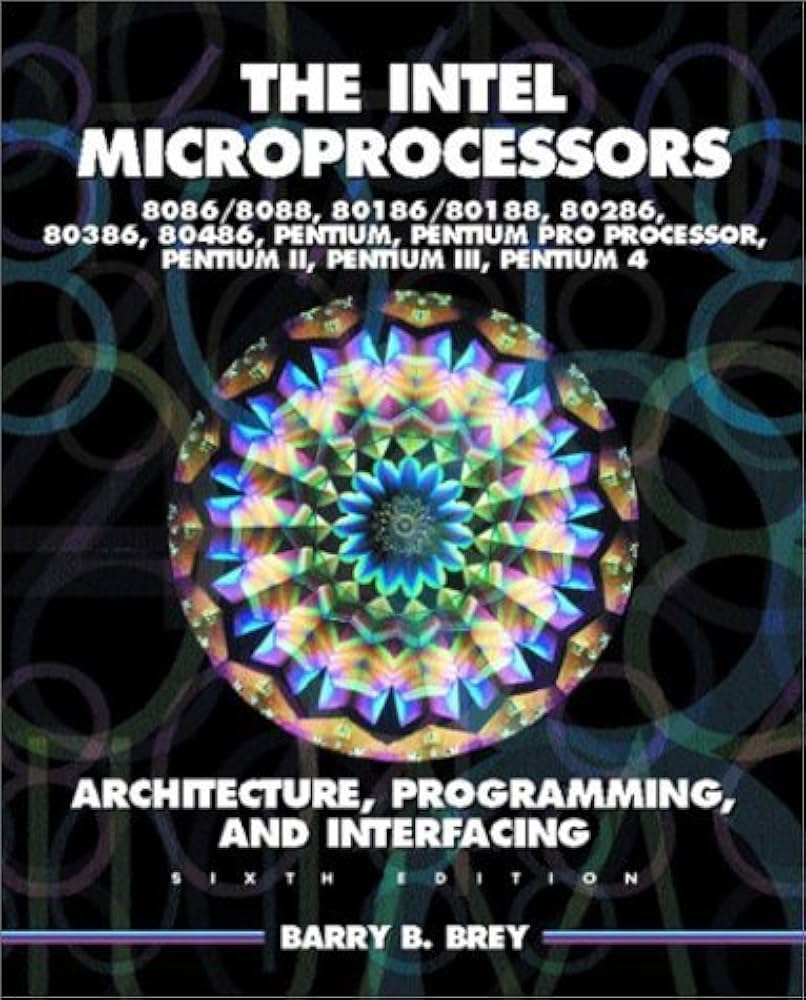
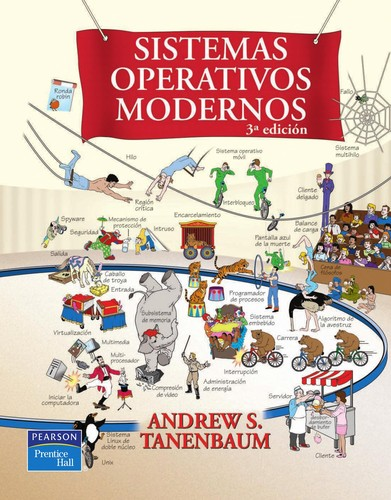

  

    
  

<h1 align="center">
  Herman Semenoff
</h1>

## About me

I have HPC and Security Team, team contains only AI agents and me.

I love architectural x64, mips64 optimizations, cache management, and branch prediction.

I'm always trying to improve everything, and I have a lot of closed forks of large projects.

Sometimes, out of boredom, I can open them and merge changes to mainline branch of the project.

I don't have much time for constant activity in opensource, I often make changes and forget to finish something.

## Stack
- Langs: C Linux, C++ Qt/Winapi/Borland, NASM, FASM, MASM, UASM
- Disassemblers: radare2/rizin, Cutter, Ida Pro, Ghidra, x64dbg
- and others static, dynamic and fuzzing analyzers

## Technical Blog & Research / Блог и исследования
- **[Porting OpenWrt to Broadcom BCM6338 with 8MB RAM (D-Link DSL-2500U D3) — Part 1](blog/openwrt-dsl2500u-part1-en.html)**  
  *Defeating locked CFE, writing a bare-metal SPI MMIO driver in MIPS assembly, fixing internal EPHY clocks, and conquering the 8MB RAM barrier.*  
  *[Read in English](blog/openwrt-dsl2500u-part1-en.html) | [Читать на русском](blog/openwrt-dsl2500u-part1-ru.html) | [阅读中文版](blog/openwrt-dsl2500u-part1-zh.html)*
- **[Все статьи / All Blog Posts →](blog/)**

## My open forks
 - [WinRing0](https://github.com/GermanAizek/WinRing0) 

Microsoft refused to cooperate with me, they do not issue an EV certificate to fix driver vulnerability. Many thanks Gamers Nexus team for highlighting this global issue on Windows.

 

    <iframe width="560" height="315" src="https://www.youtube.com/embed/H_O5JtBqODA" title="YouTube video player" frameborder="0" allow="accelerometer; autoplay; clipboard-write; encrypted-media; gyroscope; picture-in-picture; web-share" referrerpolicy="strict-origin-when-cross-origin" allowfullscreen></iframe>

 - [WebDriverxx](https://germanaizek.github.io/webdriverxx/) (Client C++ API for Selenium Server - test automation for browser-based web applications)
 - [PicoBase64](github.com/GermanAizek/picobase64) (very fast and lightweight header-only C/C++ library for decode and encode strings. [Bechmarks here!](https://rawcdn.githack.com/gaspardpetit/base64/294fac8a0e679cbe72f0a3d6f40e1a3bccba7c5d/result/result.html))
 - [AQEMU](https://github.com/AQEMU/aqemu) (Im continue maintain AQEMU)
 - [midi2mod](https://github.com/GermanAizek/midi2mod) (for demoscene and old keygens fans)
 - [NUMAyei](https://github.com/GermanAizek/NUMAyei) (attempt make Windows more NUMA-awarless using DLL hijacking winapi calls)
 - [LibreAward](https://github.com/GermanAizek/libreaward) (attempt make [Award BIOS](https://en.wikipedia.org/wiki/Award_Software) free opensource and modifyable)
 - [MT7601 driver linux](https://github.com/GermanAizek/mt7601u-hacker) (maintance Mediatek 7601U WiFi driver for Linux)
 - [LXOpenbox](https://github.com/LXunix/lxopenbox) (my Openbox fork)
 - [LXPulseAudio](https://github.com/LXunix/lxpulseaudio) (my Pulseaudio fork)
 - [LibreGoanna](https://github.com/LXunix/libregoanna-uxp) (my PaleMoon/Basilisk browser fork)
 - [and others this](https://github.com/GermanAizek?tab=repositories)

## My reverse engineered Win32 drivers

### Hardware, Monitoring, Overclocking Drivers (BYOVD / Ring-0)
- [RTCore64](https://github.com/GermanAizek/RTCore64) — reverse-engineered and restored source code of the MSI RivaTuner driver (`RTCore64.sys`) with fixes for known CVEs (including CVE-2019-16098 — arbitrary physical memory and I/O port read/write from user mode) and newly discovered vulnerabilities (insufficient IOCTL buffer validation and missing access checks).
- [ene](https://github.com/GermanAizek/ene) — reverse-engineered and restored source code of the ENE Technology driver (`ene.sys`, RGB/EC management) with fixes for arbitrary physical memory, MSR, and I/O port access vulnerabilities.
- [CorsairLLAccess64](https://github.com/GermanAizek/CorsairLLAccess64) — reverse-engineered and restored source code of the Corsair driver (`CorsairLLAccess64.sys`) with fixes for low-level hardware, I/O port, and physical memory access vulnerabilities lacking proper privilege checks.
- [NTIOLib](https://github.com/GermanAizek/NTIOLib) — reverse-engineered and restored source code of the MSI driver (`NTIOLib.sys`) with fixes for vulnerabilities (including CVE-2019-18845 — arbitrary physical memory, MSR, and I/O port read/write via unprotected IOCTLs).
- [rtkio](https://github.com/GermanAizek/rtkio) — reverse-engineered and restored source code of the Realtek driver (`rtkio.sys`) with fixes for arbitrary memory and I/O port access vulnerabilities.
- [FPCIE2COM](https://github.com/GermanAizek/FPCIE2COM) — reverse-engineered and restored source code of the PCIe-to-COM driver (`FPCIE2COM.sys`) with fixes for unsafe IOCTL handling and improper validation of user-mode pointers/buffers.
- [RadHwMgr](https://github.com/GermanAizek/RadHwMgr) — reverse-engineered and restored source code of the hardware management driver (`RadHwMgr.sys`) with fixes for arbitrary physical memory and I/O port read/write vulnerabilities.
- [cg6kwin2k](https://github.com/GermanAizek/cg6kwin2k) — reverse-engineered and restored source code of the `cg6kwin2k.sys` driver with fixes for direct physical memory mapping and missing access control checks in IOCTL handlers.
- [phymem_ext64](https://github.com/GermanAizek/phymem_ext64) — reverse-engineered and restored source code of the `phymem_ext64.sys` driver with fixes for arbitrary physical memory (`\Device\PhysicalMemory`) mapping, reading, and writing from unprivileged user mode.
- [stdcdrv64](https://github.com/GermanAizek/stdcdrv64) — reverse-engineered and restored source code of the `stdcdrv64.sys` driver with fixes for arbitrary memory read/write vulnerabilities and insufficient IOCTL input parameter validation.
- [nvoclock](https://github.com/GermanAizek/nvoclock) — reverse-engineered and restored source code of the NVIDIA overclocking driver (`nvoclock.sys`) with fixes for arbitrary physical memory, PCI configuration space, and I/O port access vulnerabilities.
- [AIDA64Driver](https://github.com/GermanAizek/AIDA64Driver) — reverse-engineered and restored source code of the AIDA64 monitoring driver (`AIDA64Driver.sys`) with fixes for vulnerabilities (including vectors such as CVE-2019-7244 / CVE-2023-41444 — arbitrary physical memory, MSR, and I/O port read/write).
- [AsusSAIO](https://github.com/GermanAizek/AsusSAIO) — reverse-engineered and restored source code of the ASUS driver (`AsusSAIO.sys`) with fixes for arbitrary physical memory and I/O port access vulnerabilities and missing device access controls.
- [cpuz](https://github.com/GermanAizek/cpuz) — reverse-engineered and restored source code of the CPUID CPU-Z driver (`cpuz.sys`) with fixes for vulnerabilities (including CVE-2017-15302 / CVE-2017-15303 — arbitrary physical memory, MSR, and PCI configuration space read/write).
- [gdrv](https://github.com/GermanAizek/gdrv) — reverse-engineered and restored source code of the GIGABYTE driver (`gdrv.sys`) with fixes for vulnerabilities (including CVE-2018-19320 — arbitrary physical memory and I/O port read/write via exposed IOCTLs).
- [dbutil_2_3](https://github.com/GermanAizek/dbutil_2_3) — reverse-engineered and restored source code of the Dell BIOS Utility driver (`dbutil_2_3.sys`) with fixes for vulnerabilities (including CVE-2021-21551 — arbitrary kernel and physical memory read/write due to missing bounds and access checks).
- [iqvw64e](https://github.com/GermanAizek/iqvw64e) — reverse-engineered and restored source code and behavior of the Intel Network Adapter Diagnostic driver (`iqvw64e.sys`) with fixes for known vulnerabilities (including CVE-2015-2291 — arbitrary kernel and physical memory read/write via IOCTLs) and newly found flaws (missing buffer bounds and address space validation).

### Windows Kernel, System Drivers
- [Afd](https://github.com/GermanAizek/Afd) — reverse-engineered and restored source code of the Windows Ancillary Function Driver (`afd.sys`) with fixes for Elevation of Privilege (EoP) vulnerabilities and memory/buffer handling flaws in WinSock IOCTL handlers.
- [CSC](https://github.com/GermanAizek/CSC) — reverse-engineered and restored source code of the Windows Client-Side Caching driver (`csc.sys`) with fixes for Elevation of Privilege vulnerabilities (including vectors like CVE-2024-26229 — improper buffer validation / IOCTL transfer method handling and out-of-bounds memory access).

### Debugging, Tooling, Security Drivers
- [windbg](https://github.com/GermanAizek/windbg) — reverse-engineered and restored source code of the debugging driver (`windbg.sys`) with fixes for unsafe kernel memory access primitives and missing privilege checks.
- [TdkLib64](https://github.com/GermanAizek/TdkLib64) — reverse-engineered and restored source code of the `TdkLib64.sys` driver with fixes for low-level memory and I/O port access vulnerabilities.
- [PDFWKRNL](https://github.com/GermanAizek/PDFWKRNL) — reverse-engineered and restored source code of the `PDFWKRNL.sys` driver with fixes for IOCTL input buffer validation flaws and arbitrary memory access vulnerabilities.
- [TmComm](https://github.com/GermanAizek/TmComm) — reverse-engineered and restored source code of the Trend Micro driver (`TmComm.sys`) with fixes for vulnerabilities (including vectors like CVE-2023-41179 — buffer overflow / arbitrary process termination and kernel memory access due to insufficient IOCTL input validation).

## My progress reverse engineering games in decomp.me

- [https://www.decomp.me/u/GermanAizek](https://www.decomp.me/u/GermanAizek)

## My favorite books

  

    
    
  

## My favorite teacher

  

    
  

<h4 align="center">
  Edward Numbless
</h4>

## For commercial inquiries and press releases
 - <[GermanAizek@yandex.ru](mailto:GermanAizek@yandex.ru)>
 - <[germanaizek0@gmail.com](mailto:germanaizek0@gmail.com)>
 - <[GermanAizek@tutamail.com](mailto:GermanAizek@tutamail.com)>

